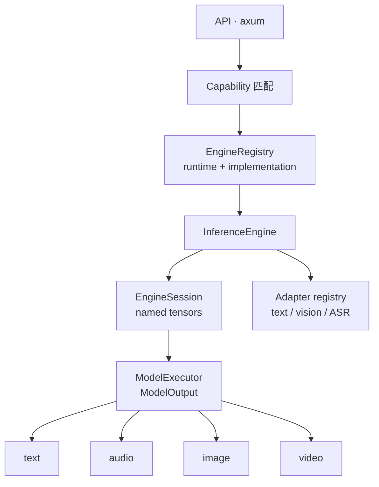

<h1 align="center">UniInfer</h1>

<p align="center">
  <b>一套 Rust 运行时，统一 ONNX、GGUF、Safetensors 的文本、语音、视觉与生成推理</b><br/>
  能力路由 · 声明式 pipeline · CPU/GPU/NPU 放置 · 桌面与移动同源
</p>

<p align="center">
  <a href="https://www.rust-lang.org"></a>
  <a href="#许可证"></a>
  <a href="docs/ARCHITECTURE.md"></a>
  <a href="#贡献"></a>
</p>

---

## 项目状态

UniInfer 当前提供以下能力：

- OpenAI 兼容的文本聊天与多图聊天，覆盖 ONNX、GGUF、Safetensors。
- ONNX Whisper / CTC 与 GGML Whisper 批量语音转写。
- `/v1/images/generations` 的图像生成管线与 `onnx.diffusion` 多组件扩散，包含 capability 选择、PNG 编码与 `b64_json` 响应。
- `/v1/realtime` 的文本与 16 kHz PCM16 音频输入、能量 VAD、ASR → 文本响应闭环。
- `/v1/models`、`/v1/devices`、`/v1/config`、`/metrics`、会话取消与模型生命周期。
- Tauri 2 桌面工作台：对话、多图、转写、图像生成、在线模型搜索/下载、模型管理与设置，与 HTTP API 共享同一运行时。

内置的 `tiny-*` ONNX 模型用于契约测试；真实模型由下载/导入流程自动生成 manifest，运行时递归探测 `models/`，无需在配置中登记。

## 设计目标

**能力路由。** 模型通过 manifest 声明 `operation`、输入、输出与 `mode`。请求按 capability 匹配模型，引擎按 `runtime + implementation + format + placement` 加载。

**ONNX 优先。** ONNX 引擎提供通用 graph 执行器与声明式 pipeline；文本、视觉、语音与图像后端共享同一套 named-tensor 契约。

**多格式统一。** ONNX、GGUF、Safetensors、GGML 通过统一 `InferenceEngine` / `EngineSession` 接入；模型差异收敛在 adapter 与 profile。

**实时与批量共用会话语义。** 取消、租约、超时、错误信封和放置计划覆盖 REST、SSE、WebSocket 与 CLI。

## 能力模型

```toml
[[capabilities]]
name = "text_chat"
operation = "generate"
required_inputs = ["text"]
optional_inputs = ["image"]
outputs = ["text"]
mode = "stream"

[[capabilities]]
name = "image_to_video"
operation = "generate"
required_inputs = ["image"]
optional_inputs = ["text"]
outputs = ["video"]
mode = "batch"

[[capabilities]]
name = "omni_chat"
operation = "generate"
required_inputs = []
optional_inputs = ["text", "audio", "image"]
outputs = ["text", "audio", "image"]
mode = "duplex"
```

capability 由五部分组成：

```text
operation
required_inputs
optional_inputs
outputs
mode
```

`required_inputs = []` 表示任何输入都可选；请求至少携带一种输入。`outputs` 描述模型支持的输出集合；一次响应输出一个或多个请求的输出，由 `ModelOutput::Parts` 承载。

`Mode::Batch` 请求可由 Batch、Stream 或 Duplex 能力服务；`Mode::Stream` 请求由 Stream 或 Duplex 能力服务；`Mode::Duplex` 精确匹配。

## 架构



- `ModelManifest` 声明 runtime、implementation、capability、格式、量化、放置与各能力配置。
- `EngineRegistry` 只匹配 runtime、implementation、format、量化、输入模态与设备放置。
- `OnnxEngine` 提供 `onnx.graph` 与 `onnx.pipeline` 两种实现。
- `CandleEngine` 提供文本 family 与视觉 family adapter。
- `llama.cpp` 提供 GGUF 文本与 mtmd 视觉。
- `ModelExecutor` 统一返回 `ModelOutput::{Text,Audio,Image,Video}`。

## 支持矩阵

| 格式 | 能力 | 实现 | 状态 |
| :--- | :--- | :--- | :--- |
| ONNX | 文本生成 / GenAI KV cache | `onnx.graph` | 已实现 |
| ONNX | 视觉语言 pipeline | `onnx.pipeline` + `smolvlm` profile | 已实现 |
| ONNX | Whisper / CTC 语音转写 | `onnx.pipeline` + adapter step | 已实现 |
| ONNX | 图像扩散 | `onnx.diffusion` + `ImageSlot` | 已实现；CLIP/UNet/VAE 组件布局，含 synthetic fixture |
| GGUF | 文本生成 | `candle.text` / `llama.text` | 已实现 |
| GGUF | 视觉语言 | `llama.mtmd` | 已实现 |
| Safetensors | 文本生成 | `candle.text` | 已实现 |
| Safetensors | 视觉语言 | `candle.vision` | 已实现 |
| GGML | Whisper 语音转写 | `whisper.ggml` | 已实现 |

### 运行配置

- 设置页提供整机级「省内存 / 平衡 / 性能」预设，可调整最大驻留模型数、GPU/主机内存预留和请求超时。
- 每个已安装模型有独立运行配置：设备策略、优先设备、CPU 回退、层卸载、KV cache 位置与上下文长度；不同大小/格式的模型分别保存。
- 模型配置会显示模型体积与 GPU/统一内存可用量，并给出自动层卸载、KV 放 RAM/VRAM 的建议。
- 统一内存与核显（Apple Silicon、Intel/AMD iGPU）按同一个主机内存池记账；CPU+GPU 混合推理不会把同一块内存重复算成 VRAM 和 RAM，GPU 预算自动继承主机预留。

### 可下载后端

- 桌面端「后端」页把内置引擎与外置 Sidecar 分开完整列出；外置后端按官方项目分组，同一项目下展示全部已安装变体。
- 自动读取 `llama.cpp`、`stable-diffusion.cpp`、`whisper.cpp` 和 `ONNX Runtime` 官方 release，按变体下载并校验；`llama-server` 走 HTTP 流式适配，`sd-server` 走图像生成适配，`whisper-server` 走 ASR `/inference` 适配，ONNX Runtime 通过 `onnx-dynamic` 构建动态加载 DLL。
- 安装到配置目录下的 `backends/`；没有全局激活状态，安装后即可在模型运行配置中选择。后端下载与模型下载共用标题栏右侧的下载弹层，支持排队、进度、取消、重试和清理。
- 每个模型可在 `[backend]` 中指定后端族与变体；变体为 `auto` 时按设备后端名称匹配加速变体，没有匹配时回退 CPU。内置引擎不需要下载，始终作为默认回退。
- 官方引擎适配和内部启动描述见 [docs/BACKENDS.md](docs/BACKENDS.md)。

### 分层驻留

- 设备探测会报告 `memory_bytes`、`available_memory_bytes` 与 `unified_memory`；CPU 来自系统内存，llama.cpp GPU 来自后端空闲显存，`IntegratedGpu` / Metal / CoreML 标记为统一内存。
- 统一内存设备参与混合推理时，层卸载与 KV cache 都从主机内存池准入；`GPU 预留` 对纯统一内存机型不生效，由 `host_reserve_mb` 控制。
- llama.cpp 默认使用 mmap，并在 GPU 上按空闲显存自动选择 `n_gpu_layers`；`placement.offload_layers = "auto"` 显式启用，数字值固定层数。
- `placement.kv_cache = "ram"` 会把 llama.cpp 的 KV cache 留在主机内存。
- `min_vram` 会在存在 GPU 空闲显存信息时参与路由；不满足则拒绝该引擎。
- 每个 `SessionLease` 在加载后预留 VRAM/RAM，释放时归还；`/metrics` 和 `/v1/models` 输出 `residency`（VRAM、host、disk-backed、层数）。
- ONNX pipeline 的 `[[pipeline.steps]]` 和 `image.diffusion` 组件可用 `device = "cpu" | "gpu" | "npu"` 做阶段级异构执行。
- 单图 ONNX 文本模型可用 `implementation = "onnx.layered"`：优先按 `layers.N` 拆层，否则按 initializer 权重大小拆分；`offload_layers` 指定前 N 层放 GPU（`"auto"` 按空闲显存估算）。有 `genai_config.json` 时阶段间复用 KV，否则走无状态阶段执行。DirectML 实测 2 层 GPU + 其余 CPU 可运行。
- Candle、ONNX 的层切分仍待实现；没有引擎统计时账本用 manifest 文件大小做保守估算。
- 加载因预算不足失败时，会按 LRU 驱逐已缓存模型并重试；`/metrics.model_evictions` 记录次数。

量化覆盖：

- ONNX：FP32、FP16、INT8、INT4。
- GGUF：Q2_K 到 Q8_0、Q4_0/Q4_1、Q5_0/Q5_1，以及 llama.cpp 的 IQ/MXFP4/NVFP4 路径。
- Safetensors：FP16、BF16。
- GGML Whisper：FP32/FP16 与常见 Q4/Q5/Q8。

## 快速开始

### 前置条件

- Rust stable。
- ONNX Runtime 由 `ort` 的 `download-binaries` feature 提供；下载 ONNX Runtime 后端并使用官方 DLL 时，启用 `onnx-dynamic` feature。
- 构建 `llama` / `llama-mtmd` feature 时安装 CMake、C++ 编译器和 `libclang`。

### 构建

```bash
cargo build -p uniinfer-cli
cargo build -p uniinfer-cli --features llama
cargo build -p uniinfer-cli --features llama-mtmd
```

### 获取模型

```bash
models/fetch.sh
models/fetch-qwen3.sh
models/fetch-qwen3-vl.sh
models/fetch-whisper.sh
models/fetch-smolvlm2-256m.sh
models/fetch-smolvlm2-256m-onnx.sh
```

### 启动桌面端

```bash
cargo desktop
```

Windows 也可以双击仓库根目录的 `desktop.cmd`。

默认加速：

- Windows：ONNX DirectML，自动使用 DX12 GPU，无 GPU 时回退 CPU。
- macOS：ONNX CoreML + Candle Metal。
- Linux：CPU。

NPU、Candle CUDA、llama.cpp Vulkan 属于可选原生加速包。开发构建可用：

```bash
cargo desktop --features ep-cuda
cargo desktop --features candle-cuda
cargo desktop --features llama-mtmd,llama-vulkan
```

### 启动服务

```bash
cargo run -p uniinfer-cli -- serve
```

服务启动时递归扫描 `models/**/manifest*.toml`，运行中新增模型可调用 `POST /v1/models/refresh` 即时发现，无需重启。桌面端下载或导入模型后会自动刷新。

需要只服务指定模型时：

```bash
cargo run -p uniinfer-cli --features llama-mtmd -- serve \
  --manifest models/qwen3-0.6b-onnx/manifest.toml \
  --manifest models/smolvlm2-256m-q4/manifest.toml
```

### CLI 文本生成

```bash
cargo run -p uniinfer-cli -- run \
  --manifest models/qwen3-0.6b-onnx/manifest.toml \
  --prompt "你好" --max-tokens 32
```

## API

### 聊天

```bash
curl http://127.0.0.1:11435/v1/chat/completions \
  -H 'Content-Type: application/json' \
  -d '{
    "model": "auto",
    "messages": [{"role": "user", "content": "用一句话解释张量并行"}],
    "max_tokens": 64,
    "stream": true
  }'
```

`model` 可省略或设为 `"auto"`。服务端按 `operation + required/optional inputs + outputs + mode` 选择匹配且可放置的模型。

`enable_thinking`（可选，默认由模型模板决定；桌面端默认开启）控制支持思考的聊天模板。思考内容通过非流式 `message.reasoning_content` 和流式 `delta.reasoning_content` 返回，`content` 只包含最终回答。服务端兼容 `<think>`、` thinking`、`<|channel>thought` 等常见标记，并支持标记跨流式分片。

### 多图聊天

```bash
curl http://127.0.0.1:11435/v1/chat/completions \
  -H 'Content-Type: application/json' \
  -d '{
    "model": "auto",
    "messages": [{"role": "user", "content": [
      {"type": "image_url", "image_url": {"url": "data:image/png;base64,..."}},
      {"type": "text", "text": "比较两张图："},
      {"type": "image_url", "image_url": {"url": "data:image/png;base64,..."}}
    ]}],
    "max_tokens": 32
  }'
```

图像输入支持 base64 `data:` URL、单请求多图、每图 20 MiB、最多 256 图。音频与视频 content part 返回稳定的 `400 unsupported_content`。

### 语音转写

```bash
curl http://127.0.0.1:11435/v1/audio/transcriptions \
  -F model=auto \
  -F file=@sample.wav
```

`response_format` 支持 `json`、`text`、`verbose_json`、`srt`、`vtt`。

### 图像生成

```bash
curl http://127.0.0.1:11435/v1/images/generations \
  -H 'Content-Type: application/json' \
  -d '{
    "model": "auto",
    "prompt": "a red cube",
    "size": "64x64",
    "response_format": "b64_json"
  }'
```

当前响应包含 `b64_json`、`mime_type`、`width`、`height`。`tiny-image-onnx` 验证单图管线，`tiny-diffusion-onnx` 验证 CLIP/UNet/VAE 多组件扩散；真实 SD-Turbo 通过同一个 `ImageSlot` 接入。

### 采样与停止

聊天支持 `temperature`、`top_p`、`top_k`、`seed`、`frequency_penalty`、`presence_penalty` 与 `stop`。流式与非流式共用字节级停止匹配器。

### API 一览

| 端点 | 方法 | 状态 | 用途 |
| :--- | :--- | :--- | :--- |
| `/v1/chat/completions` | POST | 已实现 | 文本 / 多图生成，SSE |
| `/v1/audio/transcriptions` | POST | 已实现 | Whisper / CTC 转写 |
| `/v1/audio/speech` | POST | 稳定 501 | 语音合成 |
| `/v1/images/generations` | POST | 管线已实现 | 文生图，`b64_json` |
| `/v1/images/edits` | POST | 稳定 501 | img2img / inpaint |
| `/v1/videos/generations` | POST | 稳定 501 | 视频生成 |
| `/v1/realtime` | WS | 已实现 | 文本/音频输入，VAD，ASR→文本 |
| `/v1/models` | GET | 已实现 | 模型、capability、路由与放置 |
| `/v1/devices` | GET | 已实现 | 设备与 EP |
| `/v1/models/{id}/load` | POST | 已实现 | 预加载 |
| `/v1/models/{id}/unload` | POST | 已实现 | 卸载 |
| `/v1/sessions/{id}/cancel` | POST | 已实现 | 取消生成 |
| `/v1/config` | GET/PUT | 已实现 | 持久配置 |
| `/metrics` | GET | 已实现 | 请求、队列、token、ASR 指标 |

## 模型清单

```toml
id = "qwen3-0.6b-onnx-int4"
runtime = "onnx"
implementation = "onnx.graph"
format = "onnx"
quantization = "int4"
streaming_capable = true
context_len = 4096
tokenizer = "hf"
min_vram = "1GiB"

[placement]
policy = "auto"
prefer = ["gpu", "cpu"]
allow_cpu_fallback = true

[text]
vocab_size = 151936
eos_token = 151645
family = "qwen3"
config_file = "config.json"
tokenizer_file = "tokenizer.json"

[[files]]
path = "model.onnx"
sha256 = "..."

[[capabilities]]
name = "text_chat"
operation = "generate"
required_inputs = ["text"]
outputs = ["text"]
mode = "stream"
```

视觉模型增加 `[vision]`：

```toml
[vision]
family = "smolvlm"
image_token = "<image>"
image_token_id = 49190
image_seq_len = 64
global_image_token_id = 49152
fake_image_token_id = 49189
```

ONNX 多图模型增加 `[pipeline]`：

```toml
[pipeline]
image_preprocessor = "smolvlm"
preprocessor_file = "preprocessor_config_512.json"
token_layout = "smolvlm"
output = "decoder.logits"

[[pipeline.steps]]
kind = "graph"
name = "vision"
file = "vision_encoder_q4.onnx"
inputs = { pixel_values = "preprocess.pixel_values", pixel_attention_mask = "preprocess.pixel_attention_mask" }

[[pipeline.steps]]
kind = "merge"
source = "vision.image_features"
target = "embed.inputs_embeds"
token = "image"

[[pipeline.steps]]
kind = "graph"
name = "decoder"
file = "decoder_model_merged_q4.onnx"
inputs = { inputs_embeds = "embed.inputs_embeds" }
auto = ["attention_mask", "position_ids", "past_key_values"]
```

图像模型增加 `[image]`：

```toml
[image]
width = 64
height = 64
```

## 项目结构

```text
crates/
  uniinfer-core        contract、manifest、capability、tensor
  uniinfer-registry    runtime/implementation 路由与租约
  uniinfer-engine-onnx ONNX graph / pipeline / ASR adapter
  uniinfer-engine-candle Candle text / vision family
  uniinfer-engine-llama  llama.cpp text / mtmd
  uniinfer-engine-whisper whisper.cpp
  uniinfer-engine-whisper-server whisper.cpp whisper-server 适配
  uniinfer-service     ModelSlot / AudioSlot / ImageSlot / ModelExecutor
  uniinfer-router      会话、指标、取消
  uniinfer-api         OpenAI REST / SSE / WebSocket
  uniinfer-cli         CLI / serve
apps/desktop           Tauri 2 桌面工作台（原生 ES modules）
```

## 依赖策略

- `ort` 固定版本，使用 `download-binaries`。
- Candle 固定版本；模型 family 通过 adapter 注册。
- `llama-cpp-2` 内置编译，feature 门控。
- `onnx.diffusion` 作为图像生成主路径；`plakat` 承载 GGUF/Safetensors 图像后端；`candle-video` 承载视频后端。

## 性能与基线

`/metrics` 暴露 active/loaded、队列等待、生成耗时、TTFT、token、ASR 音频时长与按模型计数。性能数据通过 `uniinfer-bench` 和真实模型测试记录。

## 路线图

**M6 · ONNX 扩散。** 新增 `onnx.diffusion`：CLIP 文本编码器、UNet、VAE 解码器与 Euler 调度器；首个模型 `sd-turbo-onnx`，512×512、1–4 步、固定 seed、逐步进度与 OOM 预检。SD1.5、SDXL、FLUX ONNX 随后接入。

**当前 · 多图输入。** `/v1/chat/completions` 支持单请求多张图片，ONNX pipeline、Qwen3-VL 与 llama.cpp mtmd 按标记顺序处理。

**M7 · 图像编辑与视频。** `/v1/images/edits` 支持 img2img、inpaint、outpaint；`/v1/videos/generations` 提供异步 job、查询、取消；`candle-video` LTX-Video 2B/13B 与 `plakat` AnimateDiff 输出 MP4。

**M8 · 实时多通道。** TTS 与 `output.audio`；`output.image` 预览帧；`output.video` 逐帧处理；首音频/首帧延迟、背压、丢旧帧与打断级联。

**M9 · 设备矩阵。** ONNX CUDA、TensorRT、CoreML、DirectML、ROCm、OpenVINO、QNN、NNAPI、Vitis AI、CANN；Candle CUDA/Metal；T1–T4 混合推理与代价模型。

**M10 · 移动端。** Tauri 2 iOS/Android、PCM 音频 I/O、NPU/GPU/CPU 按机型放置、三台真机语音对话。

**M11 · 可选引擎与规模化。** `frink` GGUF 可选引擎、`mistral.rs` Safetensors 评估、多模型 LRU、显存预算、预热池、打包与模型下载管理。

详细交付、出口标准、决策门与风险见 [ROADMAP](docs/ROADMAP.md)。

## 文档

- [架构契约](docs/ARCHITECTURE.md)
- [设计说明](docs/DESIGN.md)
- [路线图](docs/ROADMAP.md)

## 贡献

提交前运行：

```bash
cargo fmt --all -- --check
cargo clippy --workspace --all-targets -- -D warnings
cargo test --workspace
cargo deny check
```

默认测试只使用 `tiny-*` fixture；真实模型测试标记为 `#[ignore]`，需要显式 `--ignored` 且本地已有权重。

## 安全

- 模型文件在加载前校验 SHA-256。
- API token 通过配置或环境变量提供。
- 图像输入限制 20 MiB；请求体由 `max_body_bytes` 限制。
- 取消、超时与卸载共用 `CancelToken` 和租约释放路径。

## 致谢

感谢 ONNX Runtime、Candle、llama.cpp、whisper.cpp、tokenizers、axum、Tauri 与 Rust 社区。

## 许可证

MIT OR Apache-2.0。

### 贡献许可

提交贡献即表示同意以 MIT OR Apache-2.0 双许可发布。
