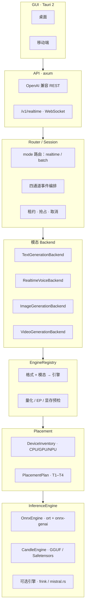

<h1 align="center">UniInfer</h1>

<p align="center">
  <b>一套 Rust 运行时，统一 ONNX、GGUF、Safetensors 的实时与批量推理</b><br/>
  实时双工四通道 · 图像与视频生成 · CPU/GPU/NPU 混合推理 · 桌面与移动同源
</p>

<p align="center">
  <a href="#项目状态"></a>
  <a href="https://www.rust-lang.org"></a>
  <a href="#许可证"></a>
  <a href="docs/DESIGN.md"></a>
  <a href="#贡献"></a>
</p>

---

## 项目状态

**设计阶段。** 架构与里程碑已定稿（[DESIGN](docs/DESIGN.md) · [ROADMAP](docs/ROADMAP.md)），实现从路线图 M0 起推进。下文的能力、接口、命令与清单格式是目标契约，v0.1 发布前保持演进；支持状态以矩阵与路线图门禁为准。

## 目录

- [设计目标](#设计目标)
- [核心特性](#核心特性)
- [架构](#架构)
- [支持矩阵](#支持矩阵)
- [快速开始](#快速开始)
- [模型清单](#模型清单)
- [API 一览](#api-一览)
- [项目结构](#项目结构)
- [性能与基线](#性能与基线)
- [路线图](#路线图)
- [文档](#文档)
- [贡献](#贡献)
- [安全](#安全)
- [致谢](#致谢)
- [许可证](#许可证)

## 设计目标

**一个路由层覆盖三种格式。** 模型格式在加载时检测，`EngineRegistry` 按「格式 × 模态」解析引擎；调用方通过模型清单指定可选引擎。

**实时与批量两条通道正交。** 实时通道承载渐进预览帧、逐帧处理与流式语音；批量通道承载端到端图像与视频生成。同一格式可以在两条通道上分别路由。

**四路输入、四路输出。** `text`、`audio`、`image`、`video` 在事件流中地位对等，编排式与原生全双工后端共享同一套帧循环语义。

**一套 API，桌面与移动同源。** `axum` 提供 OpenAI 兼容 REST 与 WebSocket；Tauri 2 复用同一 Web UI 交付桌面与移动应用。

**CPU、GPU、NPU 统一放置。** `DeviceInventory` 探测三类设备与可用 EP，`PlacementPlan` 按内存、带宽与代价模型分配算子、层与阶段；混合推理覆盖 EP 分区、层卸载、阶段分置与跨引擎组合。

## 核心特性

- **三格式统一接入**：ONNX 走 `ort` + `onnx-genai`；GGUF 与 Safetensors 走 `CandleEngine`，同一 `InferenceEngine` 契约。
- **实时双工**：`/v1/realtime` 支持文本、音频、图像、视频四通道；打断级联在 3 帧内生效，取消语义跨层传播。
- **生成能力**：图像覆盖 SD 1.5/2.1、SDXL、SD 3/3.5、FLUX.1-dev、PixArt-Σ、Stable Cascade，支持 img2img、inpaint、LoRA/DoRA 堆叠与 AnimateDiff；视频覆盖 LTX-Video 2B/13B 与 AnimateDiff。
- **显式能力声明**：格式、量化、模态、设备类别、EP 的支持状态同时来自模型清单与 `capabilities()`；降级路径附带稳定 `fallback_reason`。
- **加载期预检**：量化、EP、显存与放置可行性四项在 `load_session` 前校验，错误在请求入口返回，推理循环保持干净。
- **取消与租约**：`CancellationToken` + RAII `SessionLease`，客户端断开、任务取消、模型驱逐共用一条释放路径，覆盖 CPU/GPU/NPU 资源。
- **异构放置**：CPU、GPU、NPU 统一探测；GPU 覆盖 CUDA、TensorRT、Metal、DirectML、ROCm、OpenVINO，NPU 覆盖 QNN、NNAPI、CoreML（ANE）、OpenVINO、CANN。
- **混合推理**：算子级 EP 回退、层与 KV 卸载、阶段分置、跨引擎组合四层可选，回退与迁移均进入 `PlacementPlan` 与指标。
- **纯 Rust 推理路径**：服务端、引擎、桌面外壳与移动端共享同一代码库。
- **可观测**：请求、加载、prefill、decode 分层 span，延迟直方图与会话计量随每个里程碑扩展。

## 架构



引擎契约保持最小，模态语义由 Backend 层承载：

```rust
pub trait InferenceEngine: Send + Sync {
    fn engine_name(&self) -> &'static str;
    fn supported_formats(&self) -> &[ModelFormat];
    fn supported_modalities(&self, format: ModelFormat) -> &[Modality];
    fn supported_quantizations(&self, format: ModelFormat) -> &[Quantization];
    fn supported_devices(&self) -> &[DeviceClass];
    fn capabilities(&self) -> EngineCapabilities;
    fn load_session(&self, spec: EngineLoadSpec) -> Result<EngineSession>;
}
```

`EngineSession` 提供 `run`、`run_streaming`、`cancel`；`EngineLoadSpec` 携带 `PlacementPlan`，帧循环、背压与打断级联在 Router 层实现，引擎按计划执行与取消。

## 支持矩阵

| 格式 | 模态 | 默认引擎 | 可选引擎 | 通道 |
| :--- | :--- | :--- | :--- | :--- |
| ONNX | 文本 / 嵌入 / 双工 / 图像 / 逐帧视频 | `OnnxEngine` | — | realtime + batch |
| GGUF | 文本 / 视觉语言 / 双工 | `CandleEngine` | `frink` | realtime + batch |
| GGUF | 图像生成 | `CandleEngine`（plakat） | — | batch |
| GGUF | 视频生成 | `CandleEngine`（candle-video / plakat） | — | batch |
| Safetensors | 文本 / 视觉语言 / 双工 | `CandleEngine` | `mistral.rs` | realtime + batch |
| Safetensors | 图像生成 | `CandleEngine`（plakat） | — | batch |
| Safetensors | 视频生成 | `CandleEngine`（candle-video / plakat） | — | batch |
| ONNX | 实时预览帧 | `OnnxEngine` | — | realtime |
| ONNX | 实时逐帧视频 | `OnnxEngine` + RAVE | — | realtime |

**量化**：GGUF 覆盖 Q2_K–Q8_0、Q4_0、Q8_0；FP8 在加载期返回 `UnsupportedQuantization` 并给出替代建议；IQ/MXFP4 由 `frink` 可选引擎覆盖。Safetensors 以 FP16/BF16 mmap 加载，FP8 的 ISQ 路径在 M11 评估。

**设备类别与 EP**：

| 设备类别 | 平台 | `OnnxEngine` EP | `CandleEngine` 后端 | 放置角色 |
| :--- | :--- | :--- | :--- | :--- |
| CPU | 全平台 | CPU EP | CPU | 回退执行、层卸载、小模型常驻 |
| GPU | Windows / Linux NVIDIA | CUDA、TensorRT | CUDA | prefill/decode 主力、扩散与视频 |
| GPU | macOS / iOS | CoreML（GPU 委派） | Metal | 实时双工与生成主力 |
| GPU | Windows 通用 | DirectML | CPU / CUDA | 跨厂商 GPU 路径 |
| GPU | Android | NNAPI（GPU 委派） | — | 轻量视觉/语音前端 |
| GPU | Linux AMD / Intel | ROCm、OpenVINO | — | 经 `OnnxEngine` 覆盖 |
| NPU | Android | QNN、NNAPI（NPU/DSP 委派） | 经 `OnnxEngine` 路由 | ASR/TTS、常驻小模型 |
| NPU | Windows Copilot+ | QNN、OpenVINO | 经 `OnnxEngine` 路由 | 语音前端、低功耗推理 |
| NPU | Apple Silicon / iOS | CoreML（ANE 委派） | 经 `OnnxEngine` 路由 | 语音与视觉编码器 |
| NPU | 服务器 Ascend | CANN | 经 `OnnxEngine` 路由 | 高并发语音/视觉前端 |

**混合推理**：

| 层级 | 机制 | 承载 | 典型场景 |
| :--- | :--- | :--- | :--- |
| T1 算子级 | ORT 图分区，未覆盖算子回退 CPU | `OnnxEngine` | NPU 算子覆盖不完整的模型 |
| T2 层与缓存级 | transformer 层、KV cache 按预算分置 | `CandleEngine` | 权重超过单卡显存 |
| T3 阶段级 | 编码器、骨干、解码器、VAE 分置 | `plakat`、`candle-video`、编排式双工 | ASR 在 NPU、LLM 在 GPU、TTS 在 CPU |
| T4 引擎级 | Router 按模态或阶段分配引擎 | `OnnxEngine` + `CandleEngine` | NPU 语音前端 + GPU 文本生成 |

放置策略为 `auto`、`pinned`、`strict`；`PlacementPlan` 记录阶段→设备、卸载层数、KV cache 位置与回退清单，经 `/v1/models` 与会话 span 可查。NPU 路径由 `OnnxEngine` 的 EP 承载，`CandleEngine` 负责 CPU、CUDA、Metal。

## 快速开始

### 前置条件

- Rust stable 工具链
- 一个受支持的模型文件（GGUF、Safetensors 或 ONNX）及其清单
- CPU、GPU 或 NPU 之一；EP 以编译期 feature 选择，混合推理由放置计划编排

### 构建

```bash
cargo build --release
```

按目标平台选择 EP feature：

```bash
cargo build --release --features ep-cuda      # NVIDIA GPU
cargo build --release --features ep-coreml    # Apple GPU / ANE
cargo build --release --features ep-directml  # Windows GPU
cargo build --release --features ep-qnn       # Qualcomm NPU
cargo build --release --features ep-openvino  # Intel GPU / NPU
```

设备探测：

```bash
cargo run -p uniinfer-cli --release -- devices
```

输出 CPU/GPU/NPU 的设备编号、可用 EP、内存与带宽，以及默认 `PlacementPlan`。

### 启动服务

```bash
cargo run -p uniinfer-cli --release -- serve --addr 127.0.0.1:8080
```

一次性推理：

```bash
cargo run -p uniinfer-cli --release -- run \
  --manifest models/qwen2.5-1.5b-instruct-q4_k_m.toml \
  --prompt "用一句话解释张量并行" \
  --max-tokens 64
```

### 调用

流式聊天：

```bash
curl -N http://127.0.0.1:8080/v1/chat/completions \
  -H 'Content-Type: application/json' \
  -d '{
    "model": "qwen2.5-1.5b-instruct-q4_k_m",
    "messages": [{"role": "user", "content": "用一句话解释张量并行"}],
    "stream": true
  }'
```

图像生成：

```bash
curl http://127.0.0.1:8080/v1/images/generations \
  -H 'Content-Type: application/json' \
  -d '{
    "model": "flux.1-dev-q5_k_m",
    "prompt": "雨夜的霓虹街道，电影感，35mm",
    "size": "1024x1024",
    "steps": 20,
    "seed": 42
  }'
```

视频生成走异步任务：

```bash
curl http://127.0.0.1:8080/v1/videos/generations \
  -H 'Content-Type: application/json' \
  -d '{"model": "ltx-video-2b-distilled", "prompt": "海浪拍打礁石，日出", "duration": 2}'
# → {"id": "job_7f3c", "status": "queued"}

curl http://127.0.0.1:8080/v1/videos/generations/job_7f3c
```

### 桌面端

```bash
cd apps/desktop
cargo tauri dev
```

应用启动时拉起 loopback API，退出时回收进程树；麦克风与音频播放由 Tauri 插件提供。

## 模型清单

清单描述模型的格式、量化、能力与资源需求，加载前完成路由与预检：

```toml
schema_version = 1
id = "qwen2.5-1.5b-instruct-q4_k_m"
format = "gguf"
quantization = "q4_k_m"
modalities = ["text"]
streaming_capable = true
context_len = 32768
tokenizer = "qwen2"
min_vram = "2GiB"
supported_devices = ["cpu", "gpu"]
supported_engines = ["candle"]
supported_eps = ["cuda", "metal", "cpu"]

[placement]
policy = "auto"
allow_cpu_fallback = true
stages.llm = "gpu"
offload_layers = "auto"
kv_cache = "auto"

[[files]]
path = "qwen2.5-1.5b-instruct-q4_k_m.gguf"
sha256 = "9f8e6c1d0a4b7e2f5c8d1a3b6e9f0c2d4a7b1e8f3c6d9a2b5e0f4c7d1a8b3e6f"  # 由 fetch 脚本写入
```

字段说明见 [ROADMAP · M0](docs/ROADMAP.md)；清单校验失败返回 `ManifestInvalid`，不支持的量化为 `UnsupportedQuantization`，放置无法满足时返回 `PlacementUnsatisfiable`。`auto` 允许按预算回退并记录 `fallback_reason`，`pinned` 固定阶段设备，`strict` 关闭算子回退。

## API 一览

| 端点 | 方法 | 用途 |
| :--- | :--- | :--- |
| `/v1/chat/completions` | POST | 文本生成，`stream: true` 走 SSE |
| `/v1/audio/transcriptions` | POST | 语音转写 |
| `/v1/audio/speech` | POST | 语音合成 |
| `/v1/images/generations` | POST | 文生图 |
| `/v1/images/edits` | POST | img2img / inpaint / outpaint |
| `/v1/videos/generations` | POST | 视频生成任务 |
| `/v1/videos/generations/{id}` | GET | 任务查询 |
| `/v1/realtime` | WS | 四通道实时会话 |
| `/v1/models` | GET | 清单、能力矩阵与放置计划 |
| `/v1/sessions/{id}/cancel` | POST | 取消生成 |

实时会话以 JSON 文本帧承载控制事件，以 20ms PCM16 二进制帧承载音频：

```json
{"type": "session.start", "model": "moshi-duplex-8bit", "channels": ["text", "audio"]}
{"type": "input_audio_buffer.append"}
{"type": "response.create"}
```

服务端事件覆盖 `output.text.delta`、`output.audio.delta`、`output.audio.clear`、`output.image.preview`、`output.video.frame` 与 `response.done`。

## 项目结构

```
crates/
  uniinfer-core          # 枚举、Manifest schema、EngineError、Trait
  uniinfer-devices       # DeviceInventory、代价模型、PlacementPlan
  uniinfer-registry      # 格式+模态路由、预检、SessionLease、显存预算
  uniinfer-engine-onnx   # ort + onnx-genai；EP feature 门控
  uniinfer-engine-candle # candle-core/transformers；GGUF / Safetensors
  uniinfer-backends      # 四个模态 Backend，引擎无关
  uniinfer-router        # mode 路由、帧编排、打断级联、异步任务
  uniinfer-api           # axum 路由、OpenAI 兼容层、WebSocket
  uniinfer-cli           # 冒烟、清单校验、bench 驱动
  uniinfer-bench         # 场景矩阵与基线对比
apps/desktop             # Tauri 2（桌面 + 移动）
models/                  # manifest + fetch 脚本 + sha256
scripts/e2e/             # 里程碑出口脚本
```

依赖方向由 `cargo metadata` 在 CI 断言：`uniinfer-devices` 位于 core 与 registry 之间，`uniinfer-backends` 的依赖闭包限定在 core 与 registry，`engine-*` 之间互不依赖。

## 性能与基线

性能以「场景 × 模型 × 引擎 × 设备类别 × EP」矩阵测量，结果写入 `bench/baseline.json`（含设备与驱动信息），由 `bench compare` 做回归判定：+10% 报警，+25% 阻塞。

```bash
cargo run -p uniinfer-bench --release -- run --scenario text
cargo run -p uniinfer-bench --release -- compare --baseline bench/baseline.json
```

指标覆盖 TTFT、tok/s、实时因子、首音频延迟、首帧预览延迟、每图/每片段耗时、峰值显存与跨设备迁移字节。

## 路线图

| 阶段 | 主题 | 里程碑 |
| :--- | :--- | :--- |
| 控制面 | 契约 → REST/SSE → 桌面端 → 双工语音 | M0–M3 |
| 引擎 | GGUF 文本 → Safetensors/双工 | M4–M5 |
| 设备 | NPU EP、PlacementPlan、T1–T4 混合推理 | M6 |
| 生成 | 图像 → 视频 | M7–M8 |
| 合并 | 预览帧与逐帧视频 | M9 |
| 扩展 | 移动端、可选引擎与规模化 | M10–M11 |

完整出口门禁、决策门与风险登记见 [ROADMAP](docs/ROADMAP.md)。当前里程碑：**M0 走路骨架**。

## 文档

| 文档 | 内容 |
| :--- | :--- |
| [DESIGN.md](docs/DESIGN.md) | 分层架构、引擎路由、格式-模态矩阵、EP 策略 |
| [ROADMAP.md](docs/ROADMAP.md) | 里程碑、出口门禁、决策门、风险登记 |
| `docs/decisions/` | 架构决策记录，随对应里程碑落地 |
| `docs/ENGINE_MATRIX.md` | 引擎一致性表，随 M5 交付 |

## 贡献

1. 先在 Issue 中对齐范围与接口；路由、Trait、事件协议属于契约变更，需附设计说明。
2. 提交前运行：

   ```bash
   cargo fmt --all -- --check
   cargo clippy --workspace --all-targets -- -D warnings
   cargo test --workspace
   ```

3. 新增引擎需通过 `tests/engine_contract.rs` 的全量契约断言，并在一致性表登记支持矩阵。
4. 行为变更与文档修订同批合入；决策记录写入 `docs/decisions/`。

## 安全

模型权重携带各自的许可证与使用条款，分发与商用前请核对上游模型卡片。安全问题请通过仓库的 Security Advisory 私下报告，附复现步骤与影响范围。

## 致谢

UniInfer 建立在以下项目之上：

- [Candle](https://github.com/huggingface/candle) — Rust 张量与模型框架
- [ort](https://github.com/pykeio/ort) — ONNX Runtime 的 Rust 绑定
- [onnx-genai](https://github.com/justinchuby/onnx-genai) — ONNX 生成式推理
- [plakat](https://github.com/vulogov/plakat) — Candle 图像生成
- [candle-video](https://github.com/FerrisMind/candle-video) — LTX-Video 的 Rust 实现
- [frink](https://crates.io/crates/frink-server) — GGUF 推理引擎
- [mistral.rs](https://github.com/EricLBuehler/mistral.rs) — Safetensors 推理与 ISQ
- [RAVE](https://github.com/acids-ircam/RAVE) — 实时音频/逐帧模型
- [Tauri](https://tauri.app) — 桌面与移动外壳

## 许可证

本项目采用 **MIT OR Apache-2.0** 双许可，任选其一：

- [Apache License, Version 2.0](LICENSE-APACHE)
- [MIT License](LICENSE-MIT)

### 贡献许可

你提交的贡献默认按 MIT OR Apache-2.0 双许可授权，适用 [Apache-2.0 §5](LICENSE-APACHE) 的条款；你以书面形式明确声明的许可安排从其声明。
