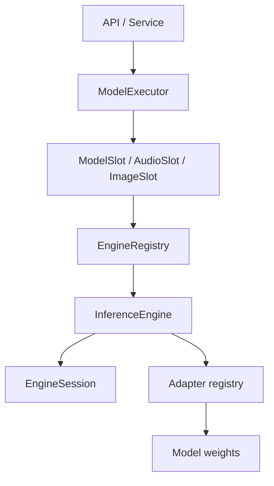

# UniInfer 架构

## 1. 原则

1. **ONNX 是通用执行层。**
2. **引擎负责能力匹配和资源执行。**
3. **模型差异放在 adapter 与 profile。**
4. **manifest 是唯一契约。**
5. **请求按 capability 选择模型。**

## 2. 路由

```text
manifest.runtime          onnx | candle | llama | whisper | process
manifest.implementation   onnx.graph | onnx.pipeline | candle.text | ...
manifest.capabilities     operation + inputs + outputs + mode
```

`EngineRegistry` 匹配：

```text
runtime + implementation + format + quantization + input modalities + placement
```

请求先形成 `CapabilityRequest`：

```text
request -> CapabilityRequest
        -> manifests where capability.matches(request)
        -> EngineRegistry route
        -> load
```

`model = "auto"` 或省略时按 capability 自动选择；显式模型同样校验 capability。

## 3. 分层



- **API/Service** 依赖 capability、`ModelRequest` 与 `ModelOutput`。
- **Engine** 负责格式、量化、设备与会话生命周期。
- **Adapter** 负责模型结构、预处理、token layout、解码。
- **Manifest** 负责声明。

## 4. Manifest

```toml
id = "example"
runtime = "onnx"
implementation = "onnx.pipeline"
format = "onnx"
quantization = "int4"

[[capabilities]]
name = "text_chat"
operation = "generate"
required_inputs = ["text"]
optional_inputs = ["image"]
outputs = ["text"]
mode = "stream"

[[capabilities]]
name = "image_to_video"
operation = "generate"
required_inputs = ["image"]
optional_inputs = ["text"]
outputs = ["video"]
mode = "batch"
```

配置按能力分组：

```toml
[text]      # tokenizer / vocab / chat template
[vision]    # family / image token contract
[audio]     # family / sample rate / options
[image]     # output dimensions
[pipeline]  # ONNX graph steps / bindings / merge / output
```

`family` 是 adapter 注册名；`implementation` 是引擎执行契约。

### 多图输入

聊天请求中的多个 `image_url` 按出现顺序收集，prompt 中为每张图插入一个 `vision.image_token`。`TextGenerator` 把全部图片编码进单个 `image` U8 tensor：

```text
UIIM | count: u64 | [length: u64 | bytes]*
```

ONNX pipeline 解码后批量预处理，shape 为 `[N, 1, 3, H, W]`；`merge` 把 vision 特征按标记顺序展开到对应位置。Qwen3-VL 使用 `[N, 3]` 的 `image_grid_thw` 与逐图 span；llama.cpp mtmd 为每张图创建一个 bitmap。原始未编码 payload 按单图处理，兼容直接调用 engine session 的测试。

## 5. ONNX

ONNX 提供两种实现：

- `onnx.graph`：单个 ONNX 图，named tensors 直通。
- `onnx.pipeline`：manifest 声明 graph steps、tensor bindings、merge 点、auto 输入与 output。

```toml
[pipeline]
image_preprocessor = "smolvlm"
preprocessor_file = "preprocessor_config_512.json"
token_layout = "smolvlm"
output = "decoder.logits"

[[pipeline.steps]]
kind = "graph"
name = "vision"
file = "vision_encoder_q4.onnx"
inputs = { pixel_values = "preprocess.pixel_values", pixel_attention_mask = "preprocess.pixel_attention_mask" }

[[pipeline.steps]]
kind = "merge"
source = "vision.image_features"
target = "embed.inputs_embeds"
token = "image"

[[pipeline.steps]]
kind = "graph"
name = "decoder"
file = "decoder_model_merged_q4.onnx"
inputs = { inputs_embeds = "embed.inputs_embeds" }
auto = ["attention_mask", "position_ids", "past_key_values"]
```

语音模型使用 pipeline adapter step：

```toml
[pipeline]
output = "text"

[[pipeline.steps]]
kind = "adapter"
adapter = "whisper"
```

新增 ONNX 模型时，manifest 覆盖 graph 顺序、绑定、merge、预处理 profile 与输出。只有新的图契约或新的预处理语义才新增 adapter。

## 6. 输出契约

```text
ModelOutput
  Text
  Audio
  Image
  Video

ModelEvent
  TextDelta
  Progress
```

`ModelExecutor` 是所有 slot 的公共执行入口：

```rust
fn execute(
    &self,
    request: ModelRequest,
    cancel: &CancelToken,
    on_event: &mut dyn FnMut(ModelEvent),
) -> Result<ModelOutput>;
```

`/v1/chat/completions`、`/v1/audio/transcriptions`、`/v1/images/generations` 共享这套输出语义。聊天保留专用流式路径，用于 stop、tool_calls 与 usage。

## 7. 约束

- 引擎入口不包含模型名分支。
- 路由读取 `runtime`、`implementation`、`capability` 与放置信息。
- API 通过 capability 判断能力。
- 模型清单必须具备 `runtime`、`implementation`、`capabilities`。
- 新能力先定义 capability 与 `ModelExecutor` 契约，再接模型。

## 8. 当前实现

- ONNX 文本、视觉 pipeline、Whisper/CTC 转写与图像生成 fixture。
- Candle GGUF/Safetensors 文本与 Safetensors 视觉。
- llama.cpp GGUF 文本与 mtmd 视觉。
- whisper.cpp GGML 转写。
- Tauri 2 桌面端。
