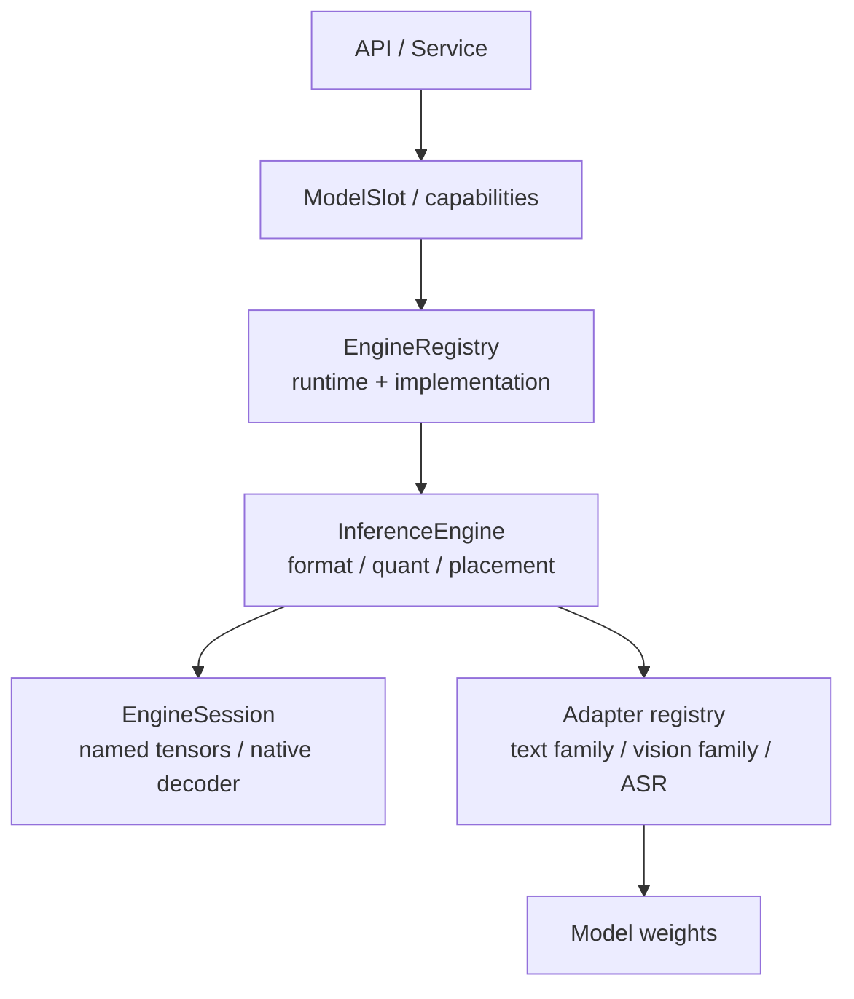

# UniInfer architecture

## 1. 原则

1. **ONNX 是通用执行层，不是某个模型的适配层。**
2. **引擎只做能力匹配和资源执行，不认识模型名。**
3. **模型差异放在 adapter / profile，不放在 `EngineRegistry`、API 或引擎入口。**
4. **manifest 是唯一契约。** 行为由声明驱动，不靠隐式约定。
5. **不做兼容层，不保留 schema 版本号。** 旧格式直接删除。

## 2. 路由

```text
manifest.runtime          onnx | candle | llama | whisper | process
manifest.implementation   adapter contract, e.g. onnx.vision / candle.text
manifest.capabilities     user-visible capability set
```

`EngineRegistry` 只匹配：

```text
runtime + implementation + format + quantization + input modalities + placement
```

它不调用 `supports_architecture`，不比较 Qwen/SmolVLM/Whisper 之类的名字。

`implementation` 是 adapter 契约，不是模型名。多个模型共享同一实现时，只新增 manifest 和 profile。

请求先形成 capability 签名，再筛选 manifest：

```text
request -> CapabilityRequest
        -> manifests where capability.matches(request)
        -> EngineRegistry route (runtime + implementation + placement)
        -> load
```

显式 `model` 也会先做 capability 校验；`model = "auto"` 或省略时按 capability 自动选择。

## 3. 分层



- **API/Service** 只依赖 capability 和 session 契约。
- **Engine** 负责资源、格式、量化和设备。
- **Adapter** 负责模型结构、预处理、token layout。
- **Manifest** 负责把三者连起来。

## 4. Manifest

```toml
id = "example"
runtime = "onnx"
implementation = "onnx.vision"
format = "onnx"
quantization = "int4"

[[capabilities]]
name = "text_chat"
operation = "generate"
required_inputs = ["text"]
optional_inputs = ["image"]
outputs = ["text"]
mode = "stream"

[[capabilities]]
name = "image_to_video"
operation = "generate"
required_inputs = ["image"]
optional_inputs = ["text"]
outputs = ["video"]
mode = "batch"
```

capability 是唯一的路由签名：`operation + required_inputs + optional_inputs + outputs + mode`。模型相关配置按能力分组：

```toml
[text]      # tokenizer / vocab / chat template
[vision]    # family / graphs / image token contract / preprocessor profile
[audio]     # family / sample rate / options
```

`family` 是 adapter 内的注册名；`implementation` 是引擎可执行契约。两者都不参与全局路由。

## 5. ONNX

ONNX 的通用路径是：

```text
graph(s) + declared inputs/outputs + adapter profile
```

当前实现：

- `onnx.graph`：单个 ONNX 图，named tensors 直通。
- `onnx.vision`：vision + embed + decoder 多图，`family = "smolvlm"` 选择预处理 profile。
- `onnx.asr.whisper` / `onnx.asr.ctc`：语音多图。

新增 ONNX 模型时，优先只新增 manifest；只有新的图契约或新的预处理语义才新增 adapter。

## 6. 约束

- 引擎入口禁止出现模型名分支。
- 路由禁止读取 `text.family` / `vision.family` / `audio.family`。
- API 禁止按 engine name 判断能力。
- 所有模型清单必须具备 `runtime`、`implementation`、`capabilities`。
- 新功能先定义 capability 和 session 契约，再接模型。

## 7. 迁移状态

已完成：

- 删除 `schema_version`。
- 删除 `InferenceEngine::supports_architecture`。
- 路由改为 `runtime + implementation`。
- ONNX 视觉实现从 `onnx_smolvlm` 改为 `onnx.vision` + `preprocessor = "smolvlm"`。
- 统一 `[text].family`、`[vision].family`、`[audio].family`。
- `native` 文本解码移出 `EngineSession`，改为独立的 `NativeTextDecoder` capability。
- `TextGenerator` 的 image 特例改为通用 auxiliary tensor 输入。
- process isolation 改为 transport 能力，不再伪装成 runtime。

待完成：

- capability 契约测试与 `/v1/models` 能力快照。
- 通用 pipeline DAG（目前 ONNX 仍是声明式参数，不是完整图 DAG）。
- 多图/视频/音频 auxiliary 输入的 API 契约。
