以下方案将 ONNX、GGUF、Safetensors 三种格式置于同一推理架构之下，**图像生成与视频生成在三种格式上均有正式路径**，实时双工覆盖文本、音频、图像、视频四条输入与四条输出通道，编排式与原生全双工后端共享同一套 Backend Trait 契约；CPU、GPU、NPU 由统一放置层调度，支持单设备与混合推理。

---

## 1. 设计原则

**原则一：格式决定引擎路由，引擎决定执行能力。** 模型格式在加载时检测，`EngineRegistry` 据此解析到对应的 `InferenceEngine`，并结合 `DeviceInventory` 生成放置计划。模态语义（双工帧循环、流式推送、打断级联）由 Backend Trait 层承载，与引擎无关。

**原则二：ONNX、GGUF、Safetensors 在架构中地位对等，路由差异仅源于生态成熟度。** `OnnxEngine` 基于 `ort` + `onnx-genai`，覆盖 ONNX 格式的全模态推理、实时流式管道和 EP 硬件加速。`CandleEngine` 原生读取 GGUF 和 Safetensors，承载文本、视觉语言模型、双工语音模型、图像生成和视频生成。三种格式在图像和视频生成上均有可运行的 Rust 实现。

**原则三：实时通道与 batch 通道正交。** 实时输出（渐进预览帧、逐帧视频处理）由流式管线承载；batch 输出（完整图像、端到端视频）由生成式管线承载。同一格式可以在两条通道上分别路由，不因为格式不同而排除任何通道。

**原则四：实时双工覆盖四条输入通道与四条输出通道。** 输入侧 `input.text`、`input.audio`、`input.image`、`input.video`；输出侧 `output.text`、`output.audio`、`output.image`、`output.video`。

**原则五：GUI 层使用 Tauri 2.x，音频 I/O 通过专用插件覆盖桌面与移动端。**

**原则六：CPU、GPU、NPU 是地位对等的设备类别，混合推理是一等执行形态。** `DeviceInventory` 在启动时探测设备类别、可用 EP、内存与带宽；`PlacementPlan` 把算子、层、阶段与模态分配到单设备或跨设备组合。单引擎内支持 EP 分区与层卸载，跨引擎支持阶段级异构流水，所有回退与组合写入 `fallback_reason` 与会话指标。


## 2. 分层架构

```mermaid
flowchart TB
    subgraph API["API 层 · axum"]
        A1["/v1/chat/completions"]
        A2["/v1/audio/transcriptions · speech"]
        A3["/v1/images/generations · edits"]
        A4["/v1/videos/generations"]
        A5["/v1/realtime · WebSocket"]
    end

    subgraph Router["Router / Session 层"]
        R1["mode 路由 · realtime / batch"]
        R2["四通道事件编排"]
        R3["会话租约 · 抢占 · 取消"]
    end

    subgraph Traits["模态 Backend Trait 层"]
        T1["RealtimeVoiceBackend"]
        T2["ImageGenerationBackend"]
        T3["VideoGenerationBackend"]
        T4["TextGenerationBackend"]
    end

    subgraph Registry["EngineRegistry"]
        RG1["ModelFormat 检测"]
        RG2["格式 + 模态 → 引擎路由"]
        RG3["引擎生命周期 · LRU"]
    end

    subgraph Placement["Placement 层"]
        P1["DeviceInventory<br/>CPU · GPU · NPU"]
        P2["PlacementPlan<br/>算子 · 层 · 阶段"]
        P3["代价模型<br/>compute + transfer"]
    end

    subgraph Engines["InferenceEngine 层"]
        E1["OnnxEngine<br/>ort + onnx-genai<br/>ONNX"]
        E2["CandleEngine<br/>candle-core + transformers<br/>GGUF · Safetensors"]
        E3["可选 GGUF 引擎<br/>frink"]
        E4["可选 Safetensors 引擎<br/>mistral.rs"]
    end

    subgraph GUI["GUI 层 · Tauri 2.x"]
        G1["tauri-plugin-microphone<br/>PCM 流"]
        G2["tauri-plugin-native-audio<br/>移动端播放"]
    end

    API --> Router --> Traits --> Registry --> Placement --> Engines
    GUI --> API
```



**`InferenceEngine` Trait** 的最小契约：

```rust
pub trait InferenceEngine: Send + Sync {
    fn engine_name(&self) -> &'static str;
    fn supported_formats(&self) -> &[ModelFormat];
    fn supported_modalities(&self, format: ModelFormat) -> &[Modality];
    fn supported_quantizations(&self, format: ModelFormat) -> &[Quantization];
    fn supported_devices(&self) -> &[DeviceClass];
    fn load_session(&self, spec: EngineLoadSpec) -> Result<EngineSession>;
}
```

`EngineSession` 暴露 `run` / `run_streaming` / `cancel`，模态 Backend 的帧循环和流式推送逻辑与引擎无关。`EngineLoadSpec` 携带 `PlacementPlan` 与 `DeviceBudget`，引擎按计划加载权重与缓存。


## 3. 引擎路由与格式-模态支持矩阵

`EngineRegistry` 根据**格式**和**模态**两个维度解析引擎。路由表是显式的，调用方可以在模型清单中指定可选引擎：

| 格式 | 模态 | 默认引擎 | 可选引擎 | 路由依据 |
| :--- | :--- | :--- | :--- | :--- |
| **ONNX** | 文本/嵌入/双工/图像/视频（实时逐帧） | `OnnxEngine` | — | `ort` 的 EP 体系和 `onnx-genai` 生成循环是 ONNX 的原生能力 |
| **GGUF** | 文本/视觉语言/双工 | `CandleEngine` | **`frink`** | Candle 覆盖 GGUF 的 K-quants 和标准量化族；frink 补充 IQ/MXFP4 和服务化并发 |
| **GGUF** | **图像生成（batch）** | **`CandleEngine`** | — | **`plakat` 原生支持 FLUX.1-dev 的 GGUF 量化，Q5_K_M 可在 16GB 显存上运行** |
| **GGUF** | **视频生成（batch）** | **`CandleEngine`** | — | **`candle-video` 的 LTX-Video 支持 GGUF 量化的 T5-XXL 文本编码器**；`plakat` 的 AnimateDiff 兼容 GGUF |
| **Safetensors** | 文本/视觉语言/双工 | `CandleEngine` | **`mistral.rs`** | Candle 的 `VarBuilder` mmap 路径成熟；mistral.rs 在 Q8 prefill/decode 和 paged attention 上有基准优势 |
| **Safetensors** | **图像生成（batch）** | **`CandleEngine`** | — | **`plakat` 原生使用 Safetensors 布局加载 SD 和 Flux 权重** |
| **Safetensors** | **视频生成（batch）** | **`CandleEngine`** | — | **`candle-video`（LTX-Video）和 `plakat`（AnimateDiff）均加载 Safetensors 权重** |

**GGUF 量化支持**是引擎选择的关键约束。Candle 覆盖 llama.cpp 的 K-quants（Q2K–Q8_0）和标准 Q4_0/Q8_0，**GGUF dequant 是 Candle 侧最完整的量化族**，但 **FP8 明确不在支持范围内**。`frink` 额外覆盖 IQ 层级和 MXFP4，提供与 llama.cpp 字节级兼容的量化工具链。模型清单中的 `quantization` 字段在加载时做预检，不支持的量化类型返回明确错误。

**Safetensors 的量化路径**：Candle 支持 BF16/FP16 Safetensors 的 mmap 加载，FP8 Safetensors 在消费级显卡上的直接运行存在限制。`mistral.rs` 通过 ISQ（原位量化）直接读取 FP16/BF16 Safetensors 并在加载时量化，其 CUDA 基准显示 Q8 prefill 在部分模型上显著优于 llama.cpp。mistral.rs 作为 Safetensors 路径上的可选引擎，在 M5 做对照评估。


## 4. 图像生成：ONNX 实时预览与 GGUF/Safetensors batch 并行

图像生成在实时通道和 batch 通道上路由到不同的格式-引擎组合。

**实时通道（`output.image`，渐进预览帧）**：由 `OnnxEngine` 的流式扩散管线承载，首帧延迟可量化，后续预览帧按扩散步持续推送。这条通道的 ONNX 流式管线在时序控制上有明确的工程实现，保持为实时 `output.image` 的默认交付路径。

**Batch 通道（`/v1/images/generations`、`/v1/images/edits`）**：**GGUF 和 Safetensors 格式的图像生成由 `CandleEngine` + `plakat` 正式承载**。`plakat` 是一个纯 Rust 的 Candle 图像生成库，覆盖 SD 1.5 / 2.1、SDXL、**SD 3 / 3.5**、**FLUX.1-dev**、PixArt-Σ 和 Stable Cascade，支持 img2img、inpaint/outpaint、LoRA/DoRA 堆叠、多 ControlNet 和 **AnimateDiff 动画生成**。它的 GGUF 支持是原生的：`--model flux-dev-gguf --flux-quant-level Q5_K_M` 可在 **16GB 显存的消费级 GPU 上运行 FLUX.1-dev**。NF4 量化进一步将 Flux transformer 压缩到约 **6GB**，纯 CPU 反量化意味着它可以在任何 Candle 设备上运行。`plakat` 的 ONNX 特性是可选的（`plakat convert-onnx` 用于重建 hosted face-model 权重），不改变它作为 Candle 图像生成路径的定位。

Router 在加载图像生成模型时，根据 `mode` 和 `format` 做正交路由：`realtime` 请求检查模型是否具备流式能力，具备则走 ONNX 流式管线，不具备则返回明确的 `fallback_reason` 并建议切换到 `batch`；`batch` 请求按格式路由到 `OnnxEngine` 或 `CandleEngine`，生成完整输出后一次性返回。


## 5. 视频生成：实时逐帧 ONNX 与端到端 GGUF/Safetensors 并行

视频生成同样在两条通道上路由到不同的格式-引擎组合。

**实时逐帧通道（`output.video`）**：由 `OnnxEngine` + **RAVE** 的帧管道承载，ONNX Runtime 静态链接，TensorRT/CUDA EP 驱动逐帧推理，decode → preprocess → inference → encode 的时序在帧循环内对齐。这条通道处理的是**逐帧生成/处理**，而非端到端视频合成。

**端到端 batch 通道（`/v1/videos/generations`）**：**GGUF 和 Safetensors 格式的端到端视频生成由 `CandleEngine` 正式承载**。核心实现是 **`candle-video`**（LTX-Video）和 **`plakat`**（AnimateDiff）。`candle-video` 是 Rust 原生的 LTX-Video 文本到视频库，支持 **2B 和 13B 模型**，BF16 推理、Flash Attention、cuDNN 和 VAE tiling，**支持 GGUF 量化的 T5 编码器**，无需 Python 运行时。LTX-Video 的 GGUF 量化同时覆盖 T5-XXL 文本编码器，使得 HD 视频生成可以在消费级 GPU 上运行。`plakat` 的 **AnimateDiff** 管线是另一条 Safetensors/GGUF 兼容的视频生成路径，支持基于 SD 1.5 的运动模块，适合短视频和动画场景。

`VideoGenerationBackend` 的 batch 实现直接调用 `CandleEngine` 的 `EngineSession`，生成完整的视频文件（MP4/GIF）后通过 `output.video` 事件或 HTTP 响应返回。模型清单中的 `streaming_capable` 字段区分实时逐帧模型和端到端生成模型：前者路由到 `OnnxEngine` 的 RAVE 管道，后者路由到 `CandleEngine` 的 `candle-video` / `plakat`。


## 6. 实时双工：四通道并行的事件流

实时双工由 `RealtimeVoiceBackend` 承载，四条输出通道在事件流中地位对等：

| 输出事件 | 实时形态 | 主要引擎路径 | 格式 |
| :--- | :--- | :--- | :--- |
| `output.text` | 逐 token 流式 | `onnx-genai` 共享解码循环 / `CandleEngine` 流式会话 | ONNX / GGUF / Safetensors |
| `output.audio` | 流式 PCM 帧 | `OnnxEngine` 原生子模块 / `CandleEngine` 双工模型 | ONNX / GGUF / Safetensors |
| `output.image` | 渐进预览帧 | `OnnxEngine` 流式扩散管线 | ONNX |
| `output.video` | 逐帧生成/处理 | `OnnxEngine` + RAVE 帧管道 | ONNX |

**GGUF 和 Safetensors 的双工模型由 `CandleEngine` 承载**。Candle 原生解析 `.safetensors` 和 `.gguf`，GGUF dequant 是 Candle 侧最完整的量化族。双工语音模型（如 Moshi 的 GGUF 8-bit 或 Safetensors bf16 权重）通过 `CandleEngine` 的 `EngineSession` 加载，`RealtimeVoiceBackend` 的帧循环驱动模型的并行流建模，**帧编排逻辑与 ONNX 路径完全一致**。如果某个 GGUF 双工模型的帧时序在 Candle 上不满足实时要求，`frink` 作为该格式的可选引擎接入；Safetensors 双工模型的吞吐优化可以评估 `mistral.rs` 的 paged attention 和 CUDA graphs。

图像和视频的实时通道保持 ONNX 原生路径，因为流式扩散管线和逐帧 RAVE 管道在时序控制上已经可量化，而 GGUF/Safetensors 在**实时流式**这条通道上没有性能优势。这不影响它们在 **batch 通道**上的正式地位。


## 7. 原生全双工模型的多格式接入

原生全双工模型在三种格式下的接入路径：

**ONNX 路径**：语言模型骨干、音频编码器、音频解码器分别导出为 ONNX 子模块，`OnnxEngine` 的 `EngineSession` 加载各子模块，`RealtimeVoiceBackend` 的帧循环驱动子模块间的时序协调。数值校验和算子兼容性逐子模块验证。

**GGUF 路径**：`CandleEngine` 原生读取 GGUF 双工模型权重，帧编排逻辑不变。`frink` 作为可选引擎在并发吞吐和 IQ/MXFP4 量化场景下提供替代执行路径。

**Safetensors 路径**：`CandleEngine` 通过 `VarBuilder` 的 mmap 惰性加载读取 Safetensors 权重，帧循环不变。`mistral.rs` 作为可选引擎在 paged attention 流式场景下评估。


## 8. 各模态的引擎归属汇总

| 模态 / 场景 | 首选引擎 | 格式 | 可选引擎 | 通道 |
| :--- | :--- | :--- | :--- | :--- |
| ONNX 全模态 / 实时管道 | `OnnxEngine` | ONNX | — | realtime + batch |
| GGUF 文本 / 双工 | `CandleEngine` | GGUF | `frink` | realtime + batch |
| GGUF 图像生成 | **`CandleEngine`（`plakat`）** | **GGUF** | — | **batch** |
| GGUF 视频生成 | **`CandleEngine`（`candle-video` / `plakat`）** | **GGUF** | — | **batch** |
| Safetensors 文本 / 双工 | `CandleEngine` | Safetensors | `mistral.rs` | realtime + batch |
| Safetensors 图像生成 | **`CandleEngine`（`plakat`）** | **Safetensors** | — | **batch** |
| Safetensors 视频生成 | **`CandleEngine`（`candle-video` / `plakat`）** | **Safetensors** | — | **batch** |
| 实时图像预览帧 | `OnnxEngine` | ONNX | — | realtime |
| 实时逐帧视频 | `OnnxEngine` + RAVE | ONNX | — | realtime |

设备类别、EP 归属与四层混合推理见 §9。


## 9. 设备类别、EP 与混合推理

CPU、GPU、NPU 是地位对等的设备类别。`DeviceInventory` 在启动时探测编译期 EP、运行期驱动、设备数量、内存与带宽，生成 `DeviceBudget`；`EngineRegistry` 结合清单与预算产出 `PlacementPlan`。

### 9.1 设备类别与 EP 归属

`ort` 的 EP 在当前基线 **2.0.0-rc.15** 中为**编译时门控**，不兼容的 EP 组合在链接时抛出错误。运行期算子回退由放置计划显式声明，并记录 `fallback_reason`。构建流水线为每个目标平台使用精确的 EP feature 组合，并在 CI 中验证链接产物。

| 设备类别 | 平台 | `OnnxEngine` EP | `CandleEngine` 后端 | 放置角色 |
| :--- | :--- | :--- | :--- | :--- |
| CPU | 全平台 | CPU EP | CPU | 回退执行、层卸载、小模型常驻 |
| GPU | Windows / Linux NVIDIA | CUDA、TensorRT | CUDA | prefill/decode 主力、扩散与视频 |
| GPU | macOS / iOS | CoreML（GPU 委派） | Metal | 实时双工与生成主力 |
| GPU | Windows AMD / Intel | DirectML | CPU / CUDA | AMD Radeon 与 Intel Arc 的 Windows 路径 |
| GPU | Android | NNAPI（GPU 委派） | — | 轻量视觉/语音前端 |
| GPU | Linux AMD | ROCm | — | AMD 独显；经 `OnnxEngine` 覆盖 |
| GPU | Linux Intel | OpenVINO | — | Intel GPU；经 `OnnxEngine` 覆盖 |
| NPU | Android | QNN、NNAPI（NPU/DSP 委派） | 经 `OnnxEngine` 路由 | ASR/TTS、常驻小模型 |
| NPU | Windows Copilot+ | QNN、OpenVINO | 经 `OnnxEngine` 路由 | 语音前端、低功耗推理 |
| NPU | AMD Ryzen AI | Vitis AI | 经 `OnnxEngine` 路由 | XDNA / XDNA2，本地语音与视觉编码 |
| NPU | Apple Silicon / iOS | CoreML（ANE 委派） | 经 `OnnxEngine` 路由 | 语音与视觉编码器 |
| NPU | 服务器 Ascend | CANN | 经 `OnnxEngine` 路由 | 高并发语音/视觉前端 |

`CandleEngine` 的原生后端是 CPU、CUDA、Metal；AMD GPU 与 NPU 由 `OnnxEngine` 的 DirectML、ROCm、Vitis AI 路径承载。Vitis AI EP 依赖 AMD 提供的 ONNX Runtime 构建（Ryzen AI SDK），标准预编译包在链接期缺 Vitis 符号。GGUF 在 AMD GPU 上的原生路径由 `frink` 的 Vulkan 后端在 M11 提供，M11 之前该组合走 Candle CPU。两类引擎在同一会话内组合时，由 Router 的放置计划编排。

### 9.2 混合推理的四个层级

| 层级 | 机制 | 承载引擎 | 典型场景 | 显式语义 |
| :--- | :--- | :--- | :--- | :--- |
| T1 算子级 | ORT 图分区：NPU/GPU 未覆盖的算子回退 CPU | `OnnxEngine` | NPU 算子覆盖不完整的模型 | `fallback_reason = "op_cpu_fallback"`；`strict` 模式返回 `PlacementUnsatisfiable` |
| T2 层与缓存级 | transformer 层、KV cache 按内存预算分置 | `CandleEngine` | 权重超过单卡显存 | `offload_layers`、`kv_cache = "cpu" / "gpu" / "auto"` |
| T3 阶段级 | 编码器、骨干、解码器、VAE 分置 | `plakat`、`candle-video`、编排式双工 | ASR 在 NPU、LLM 在 GPU、TTS 在 CPU | 每阶段设备写入 `PlacementPlan` |
| T4 引擎级 | Router 将模态或阶段分配给不同引擎 | `OnnxEngine` + `CandleEngine` | NPU 语音前端 + GPU 文本生成 | 事件流与帧协议保持一致，边界以 token/帧交接 |

放置策略由清单的 `placement` 字段选择：

```toml
[placement]
policy = "auto"            # auto | pinned | strict
allow_cpu_fallback = true
stages.asr = "npu"
stages.llm = "gpu"
stages.tts = "cpu"
offload_layers = "auto"
kv_cache = "auto"
```

- `auto`：在内存与带宽预算内选择估算延迟最低的方案；回退附带 `fallback_reason`。
- `pinned`：清单固定阶段到设备；不可满足时返回 `PlacementUnsatisfiable`。
- `strict`：算子回退关闭；任何未覆盖算子使加载失败。

`PlacementPlan` 记录阶段→设备、卸载层数、KV cache 位置、预计迁移字节与回退清单，写入会话 span 与 `/v1/models`。`uniinfer-devices` 负责探测、代价模型与计划生成；Registry 只做路由与租约。

设备探测项：EP 编译可用性与运行可用性、设备数量、显存/统一内存、PCIe/统一内存带宽、NPU 驱动版本。代价模型按 `compute + transfer` 估算，prefill 与 decode 分别评分；计划在加载时冻结，运行期沿计划内路径降级。

模型清单中的 `supported_engines`、`supported_eps`、`supported_devices`、`min_vram`、`streaming_capable`、`quantization` 与 `placement` 共同决定加载决策。预检失败返回 `PlacementUnsatisfiable` 或对应的 `fallback_reason`。


## 10. GUI、移动端与音频 I/O

GUI 层使用 **Tauri 2.x**（基线 2.12.5），桌面端和移动端共享 Web UI。音频输入通过 `tauri-plugin-microphone-kessdev` 提供跨平台的 **`startAudioStream` 原始 PCM 帧回调**。音频输出移动端对接原生播放器，桌面端由 Rust 侧管理。

**WebSocket 实时通道**通过 `axum` 或 `tokio-tungstenite` 承载四通道事件流。图像和视频的输出事件通过同一连接推送，Router 以任务标识管理异步生成的完成通知。


## 11. 实施路线

> 执行顺序、里程碑出口门禁、决策门与风险登记见 [ROADMAP.md](ROADMAP.md)。下表为阶段摘要，出口标准以路线图为准。

| 阶段 | 交付内容 | 验证标准 |
| :--- | :--- | :--- |
| **Phase 1** | `OnnxEngine` + `EngineRegistry` 最小实现，ONNX 路由；编排式全双工 + WebSocket 事件流 + Tauri 桌面端 | 端到端双工对话可用，打断生效，EP 编译时门控的 CI 通过 |
| **Phase 2** | 注册 `CandleEngine`，接入 GGUF/Safetensors 文本与双工模型；`DeviceInventory` 最小实现（CPU/GPU 探测、显存与带宽） | GGUF/Safetensors 量化预检正确；Candle 上的双工帧循环在 CUDA/Metal 上可量化；设备清单与 `PlacementPlan` 可导出 |
| **Phase 3** | `uniinfer-devices` 完整落地：NPU EP（QNN、NNAPI、CoreML、OpenVINO、Vitis AI、CANN）、AMD GPU 的 DirectML/ROCm、四层混合推理（T1–T4）、清单 `placement` 策略与代价模型 | NPU 与 CPU 数值一致性达标；层卸载让超出显存的模型可运行；跨引擎双工按阶段分置且延迟可量化；`strict` 模式正确拒绝回退 |
| **Phase 4** | **`plakat` 接入 GGUF/Safetensors 图像生成（batch）**；`mistral.rs` 作为 Safetensors 可选引擎对照评估 | **`plakat` 的 FLUX GGUF 在 16GB 显存上可运行**；mistral.rs 的吞吐对比有明确结论 |
| **Phase 5** | **`candle-video`（LTX-Video）和 `plakat`（AnimateDiff）接入视频生成（batch）**；实时图像渐进预览帧 + RAVE 逐帧视频管道；Tauri 移动端编排式双工基线 | **`candle-video` 的 LTX-Video 在 CUDA 上端到端可运行**；首帧预览延迟可量化；移动端 PCM 音频 I/O 可用 |
| **Phase 6** | `frink` 作为 GGUF 可选引擎接入；原生双工在移动端 NPU/GPU 上的逐机型验证；`mistral.rs` 是否提升为 Safetensors 默认可选引擎的决策 | frink 的 OpenAI 兼容服务层与 Router 事件流对齐；至少一个原生模型在移动端设备上达到可用实时性 |


## 12. 依赖与版本策略

**基线取上游最新稳定版；上游仅提供 RC 时取最新 RC。** 下表为文档更新时（2026-11-14）可用的最新版本，实际构建版本以 `Cargo.lock` 为准，升级后同步刷新此表。

| 依赖 | 基线版本 | 角色与约束 |
| :--- | :--- | :--- |
| Rust | 最新 stable | `rust-toolchain.toml` 固定 stable 通道；CI 使用同一版本 |
| `ort` | 2.0.0-rc.15 | ONNX Runtime；上游当前仅发布 RC |
| `onnx-genai` | 0.1.0 | ONNX 生成循环 |
| `candle-core` | 0.11.1 | GGUF/Safetensors 张量与模型 |
| `plakat` | 7.21.0 | 图像生成 |
| `candle-video` | 0.1.0 | LTX-Video 视频生成 |
| `frink-server` | 0.63.0 | 可选 GGUF 引擎 |
| `mistralrs` | 0.8.1 | 可选 Safetensors 引擎 |
| `tauri` | 2.12.5 | 桌面与移动外壳（2.x 最新稳定） |
| `tauri-plugin-native-audio` | 1.0.5 | 移动端音频输出 |
| `tauri-plugin-microphone-kessdev` | 0.1.1-beta.0 | PCM 输入；上游 beta，按风险跟踪 |
| `axum` | 0.8.9 | HTTP 与 WebSocket |
| `tokio` | 1.54.1 | 异步运行时 |

升级规则：

1. 每个里程碑启动时运行 `cargo update`、`cargo outdated`、`cargo deny check`，把可升级依赖推进到最新稳定版。
2. `Cargo.lock` 随仓库提交；服务、CLI 与发布包按锁定版本构建，并输出 SBOM 与版本清单。
3. 引擎与生成库升级时重跑契约测试、数值容差测试与 `bench compare`：图像按固定种子回归，视频记录时长与峰值显存。
4. 主版本升级附 ADR，记录 API 变更、回退方案与实测差异；升级作为独立 PR 合入。
5. EP 与驱动跟随 `ort` 支持的最新 SDK 组合（CUDA、TensorRT、CoreML、ROCm、QNN、OpenVINO、CANN），并在 CI 重新验证链接与运行矩阵。
6. 上游只提供 RC/beta 的依赖在能力清单标注通道（`rc` / `beta`），由启动探测决定路由，降级写入 `fallback_reason`。

