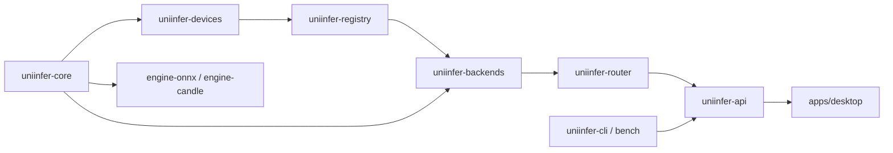
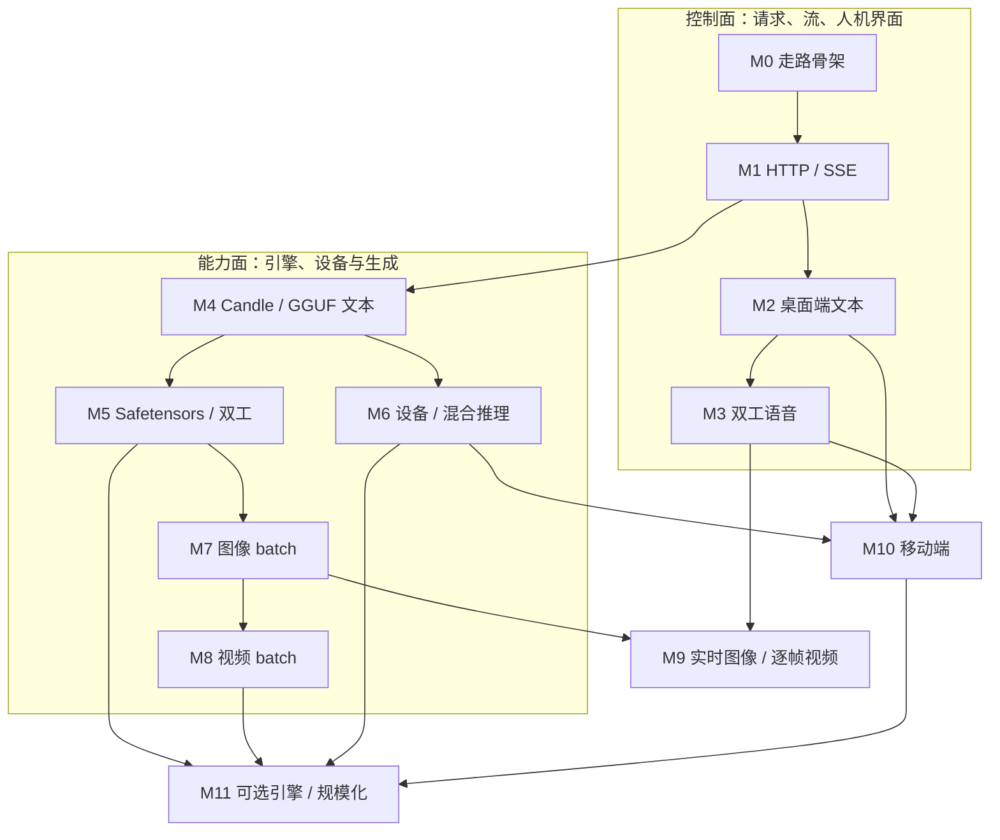

# UniInfer 渐进式路线图

本文件把 [DESIGN.md](DESIGN.md) 拆成**可独立验收的垂直切片**：每个里程碑以"一条真实请求穿过所有层"为交付单位，配可执行脚本与量化门禁。DESIGN §11 保留阶段摘要，执行顺序与出口标准以本文件为准。

**资源假设**：1–2 名熟悉 Rust 的工程师；模型转换、数据集与 UI 视觉设计作为外部输入。

---

## 1. 组织原则

1. **垂直切片优先。** 每个里程碑交付一条能演示的完整路径，用脚本或一次点击复现；分层进度在里程碑之外单独记录。
2. **接缝先行。** 单引擎时固化 Trait / Router / Registry 契约，后续引擎接入只做注册与适配，编排代码保持稳定。
3. **设备中性。** CPU、GPU、NPU 由 `DeviceInventory` 统一探测；`PlacementPlan` 在加载时冻结，算子回退、层卸载、阶段分置与跨引擎组合都写入计划与 `fallback_reason`。
4. **能力显式。** 格式、量化、模态、设备类别与 EP 的支持状态同时写入模型清单与 `capabilities()`；降级路径附带结构化 `fallback_reason`。
5. **风险前置。** 外部依赖（`onnx-genai` 流式扩散回调、RAVE 逐帧模型、plakat API、LTX 13B 显存）先以探针取得结论，结论落入 ADR 并决定范围。
6. **契约优先于数值。** 跨引擎验收同一组契约断言与质量下界；数值一致在同一引擎、同一设备、同一驱动内验收，跨设备按容差与回退计数验收。
7. **主干可运行。** `main` 始终可构建、可演示；功能以编译期 feature + 运行时 Registry 双门控。

---

## 2. 工作分解单元

```
crates/
  uniinfer-core          # 枚举、Manifest schema、EngineError、CancellationToken、Trait
  uniinfer-devices       # DeviceInventory、设备代价模型、PlacementPlan
  uniinfer-registry      # 格式+模态路由、预检、SessionLease、LRU/显存预算
  uniinfer-engine-onnx   # ort + onnx-genai；EP feature 门控
  uniinfer-engine-candle # candle-core/transformers；GGUF / Safetensors
  uniinfer-backends      # Text / RealtimeVoice / ImageGeneration / VideoGeneration
  uniinfer-router        # mode 路由、帧编排、打断级联、异步任务
  uniinfer-api           # axum 路由、OpenAI 兼容层、WebSocket
  uniinfer-cli           # 冒烟、清单校验、bench 驱动
  uniinfer-bench         # 场景矩阵与基线对比
apps/desktop             # Tauri 2（桌面 + 移动）
models/                  # manifest + fetch 脚本 + sha256；权重经脚本拉取
scripts/e2e/             # 每个里程碑的出口脚本
```

依赖方向是硬约束，由 `cargo metadata` 在 CI 断言：



`uniinfer-backends` 的依赖闭包由架构测试限定在 core 与 registry；`engine-*` 之间互不依赖。帧循环与流式推送逻辑因此保持单一实现。

---

## 3. 里程碑依赖



M0–M3 建立请求生命周期（租约、取消、帧、打断），M4–M8 建立多引擎、设备放置与生成能力，M9 将两条线合并，M10–M11 覆盖移动端与规模化。每个引擎接入都复用已经稳定的会话语义。

---

## 4. 总览

| 里程碑 | 交付能力 | 前置 | 出口门禁（摘要） |
| :--- | :--- | :--- | :--- |
| M0 | 走路骨架：Trait + Registry + 单 ONNX 模型 CLI | — | 契约测试通过；不支持的量化在加载期报错；取消 ≤ 100ms 生效 |
| M1 | `/v1/chat/completions`（含 SSE）+ 租约 + 错误契约 | M0 | 客户端断开即释放会话；TTFT 基线入库 |
| M2 | Tauri 桌面端文本对话 | M1 | 流式渲染与停止按钮生效；模型缺失或损坏时报可操作错误 |
| M3 | `/v1/realtime` 编排式双工（ASR→LLM→TTS） | M1、M2 | 打断 ≤ 3 帧生效；30 分钟浸泡内存稳定 |
| M4 | Candle 引擎 + GGUF 文本 | M1 | 同一 prompt 双引擎可读；FP8 在加载期报错 |
| M5 | Safetensors 文本 + 双工多格式 + 契约矩阵 | M4 | 一致性表填满；双工帧循环零改动复用；mistral.rs 结论落地 |
| M6 | 设备矩阵与混合推理：NPU EP、PlacementPlan、T1–T4 | M4 | CPU/GPU/NPU 探测正确；NPU 数值达标；层卸载与跨引擎双工生效 |
| M7 | 图像 batch（SD1.5→SDXL→FLUX GGUF） | M5 | 固定种子逐像素复现；FLUX 峰值显存入库 |
| M8 | 视频 batch（LTX 2B→13B、AnimateDiff） | M7 | 任务取消释放 worker 与显存；13B 结论明确 |
| M9 | `output.image` 预览帧 + `output.video` 逐帧 | M3、M7 | 首帧延迟与丢弃策略达标；RAVE 范围定案 |
| M10 | Tauri 移动端编排式双工（NPU/GPU 放置） | M2、M3、M6 | 三台真机 5 轮对话；PlacementPlan 落到 NPU；前后台切换会话保持 |
| M11 | frink / 原生双工 / 多模型驻留 | M5、M6、M8、M10 | 同模型双引擎同协议；显存预算下换入换出可证 |

依赖关系决定执行顺序；门禁通过即进入下一里程碑，门禁由脚本与基线数据判定。

---

## 5. 里程碑详述

### M0 · 走路骨架

**范围**：workspace、CI、`uniinfer-core` v1 契约、一个 ONNX 文本模型在 CPU EP 上完成一次性生成。

**交付**
- Trait 冻结 v1（后续只做加法，枚举 `#[non_exhaustive]`）：`InferenceEngine::{engine_name, supported_formats, supported_modalities, supported_quantizations, supported_devices, capabilities, load_session}`；`EngineSession::{run, run_streaming, cancel}`。
- `EngineError` 分类：`UnsupportedFormat`、`UnsupportedQuantization`、`UnsupportedEngine`、`MissingEp`、`InsufficientVram`、`ManifestInvalid`、`LoadFailed`、`Cancelled`、`Busy`、`PlacementUnsatisfiable`。
- `ModelManifest` schema v0：`id`、`format`、`quantization`、`modalities`、`streaming_capable`、`min_vram`、`files[]`（含 sha256）、`context_len`、`tokenizer`、`placement`；设备与 EP 由运行时探测。
- `DeviceInventory` 最小实现：枚举 CPU/GPU/NPU 的 EP 编译与运行可用性、内存；本里程碑走 CPU 路径。
- 依赖基线：`rust-toolchain.toml` 指向最新 stable，`Cargo.lock` 入库，`cargo deny` / `cargo outdated` 进入 CI；版本表见 DESIGN §12。
- `models/fetch.sh` 拉取极小 ONNX 文本模型（GPT-2 级）并校验摘要。
- 契约测试 `tests/engine_contract.rs` 按已注册引擎参数化。

**出口**
- `cargo test --workspace` 与 `cargo clippy -- -D warnings` 通过。
- `cargo run -p uniinfer-cli -- devices` 输出 CPU 设备、EP 可用性与内存，`PlacementPlan` 为 `cpu:0`。
- `cargo run -p uniinfer-cli -- run --manifest models/tiny-onnx/manifest.toml --prompt "hello" --max-tokens 8` 输出至少 1 个 token 的文本。
- 清单写入引擎不支持的 `quantization` 值 → 加载期返回 `UnsupportedQuantization`，推理入口保持关闭。
- 生成中触发 cancel → 返回 `Cancelled`，会话在 100ms 内释放（租约计数归零）。

**范围边界**：HTTP、WS、GUI、第二引擎、GPU EP 运行时。

---

### M1 · 文本服务面

**范围**：M0 能力以 OpenAI 兼容的 HTTP/SSE 暴露，请求生命周期在此固化。

**交付**
- axum：`POST /v1/chat/completions`（`stream: true/false`）、`GET /v1/models`、`POST /v1/sessions/{id}/cancel`。
- `uniinfer-router`：请求 → 预检 → `SessionLease` → `TextGenerationBackend` → 引擎；客户端断开触发取消。
- 背压：token 通道有界（起始容量 32）；慢客户端阻塞生成，缓冲上限固定。
- 错误信封：`{code, message, fallback_reason?}`；`fallback_reason` 为稳定字符串枚举。
- 观测：`request` / `engine.load` / `prefill` / `decode_step` 四个 tracing span；计数器覆盖活跃会话、排队数、token 数。
- CI：受控 EP feature 组合（cpu / cuda / tensorrt / coreml / directml / nnapi）编译检查；具备硬件的 runner 运行对应用例。
- `uniinfer-bench` 首个场景：TTFT、tok/s、峰值 RSS。

**出口**
- `curl -N` 可见逐 token `delta`；中途终止客户端后活跃会话计数在 1s 内归零。
- 同一 `EngineSession` 由单个租约持有；并发生成请求按策略取得 `Busy` 或排队位。
- 基线写入 `bench/baseline.json`；CI 回归阈值 +10% 报警、+25% 阻塞。

**范围边界**：音频、图像、视频路由；多模型并发；鉴权。

---

### M2 · 桌面端文本闭环

**范围**：Tauri 2 桌面应用内嵌 loopback API，验证跨进程事件与用户可感知的取消。

**交付**
- GUI 启动时拉起 `uniinfer-api`（随机 loopback 端口 + 一次性 token），退出时回收子进程。
- 界面：模型列表（来自清单）、对话、流式渲染、停止按钮、错误提示（显示 `fallback_reason`）。
- 模型缺失或损坏时返回带修复步骤的错误，进程保持运行。

**出口**
- 双击启动 → 输入 → 逐字出现；停止按钮在 100ms 内终止并释放服务端租约。
- Windows 安装包冒烟通过；冷启动到可输入 ≤ 3s（记录值）。
- 关闭窗口后进程树清空（任务管理器核对）。

**范围边界**：麦克风、音频播放、realtime、移动端。

---

### M3 · 编排式双工语音

**范围**：`/v1/realtime` WebSocket 与 `RealtimeVoiceBackend` 帧循环；行为风险最高的一步放在引擎扩张之前。

**交付**
- 协议：文本帧 = JSON 控制事件（`session.start`、`input_audio_buffer.append/commit`、`response.create/cancel`）；二进制帧 = 20ms PCM16 单声道；输出事件覆盖 `output.text/audio/image/video` 四通道命名空间（image/video 在该里程碑返回显式 `unsupported`）。
- 帧循环：ASR ONNX → LLM ONNX → TTS ONNX，20ms 帧节拍、抖动缓冲、有界队列。
- 打断级联：检测到用户语音 → 取消 TTS → 清空播放缓冲 → 取消 LLM → 发 `output.audio.clear` 与 `output.text.cancelled` → 起新响应。`InterruptPolicy` 位于 Router，引擎实现幂等 `cancel`。
- VAD 与轮次检测：能量阈值 + 静音超时。

**出口**
- `scripts/e2e/m3_duplex.sh` 回放 10 轮脚本化 PCM，全部得到文本与音频响应。
- 随机偏移插入打断：音频 ≤ 3 帧（≈60ms）停止，token 计数在 500ms 内停止增长。
- 端到端延迟（说话结束 → 首音频帧）p50/p95 入库。
- 30 分钟浸泡：RSS 增长 < 10%，队列长度有界，会话计数回到基线。

**范围边界**：原生双工模型、麦克风 GUI、移动端。

---

### M4 · Candle 引擎与 GGUF 文本

**范围**：第二个引擎，验证"格式决定路由"的接缝与模态解耦。

**交付**
- `uniinfer-engine-candle`：CUDA / Metal / CPU 后端选择；GGUF 加载与流式解码。
- 量化预检表：Q2_K–Q8_0、Q4_0/Q8_0 支持；FP8 在加载期返回 `UnsupportedQuantization` 并给出替代建议。
- Registry：`GGUF → CandleEngine`；清单 `engine` 字段可覆盖（`frink` 在 M11 前返回 `UnsupportedEngine`）。
- `capabilities()` 返回真实矩阵，供 Router 预检与 `/v1/models` 展示。

**出口**
- 同一 prompt 在 ONNX 与 GGUF 上均产出可读文本；两个引擎通过全部契约断言。
- FP8 清单返回 `UnsupportedQuantization`（含建议文案）。
- NVIDIA CUDA fp16 与 Apple Metal 的 tok/s 基线入库。
- 架构测试确认 `uniinfer-backends` 的依赖闭包由 core 与 registry 构成。

**范围边界**：Safetensors、GGUF 双工（M5）、图像、视频、frink。

---

### M5 · Safetensors、双工多格式与契约矩阵

**交付**
- Candle `VarBuilder` mmap 加载 BF16/FP16 Safetensors；FP8 Safetensors 在加载期报错并指向 M11 的 ISQ 评估。
- GGUF 与 Safetensors 双工模型接入 Candle：复用 M3 的帧循环与 `InterruptPolicy`，仅在 Registry 注册引擎与模型清单，`uniinfer-backends` 编排代码保持原样。
- 双工探针：确认目标双工模型权重（GGUF 8-bit / Safetensors bf16）在 Candle 上可加载且帧时序可驱动；探针结论为否时，本里程碑交付文本路径，双工进入 G6 决策并同步修订 DESIGN §6。
- `uniinfer-bench` 场景矩阵：模型 × 引擎 × 设备类别 × EP × prompt 集，输出 JSON；`bench compare` 对照基线。
- 引擎一致性表（`docs/ENGINE_MATRIX.md`）：格式 × 量化 × 模态 × 设备类别 × EP × 状态（支持 / 降级 / 不支持）。
- `mistral.rs` 探针：文本流式上的 TTFT / tok/s / 显存对比，产出 `docs/decisions/0002-mistral-rs.md`。

**出口**
- Safetensors 模型跑通聊天接口；一致性表覆盖全部组合。
- GGUF 与 Safetensors 双工各完成 5 轮脚本对话，RTF ≥ 1.0，打断仍 ≤ 3 帧；`uniinfer-backends` 的 diff 为零。
- 基准在 CI 覆盖 CPU 子集，GPU 子集在夜间自托管 runner 运行。
- mistral.rs 结论合并：采纳时引入依赖并注册可选引擎，否决时数据留档，`Cargo.toml` 保持 Candle 组合。

**范围边界**：ISQ、paged attention 集成、图像、视频。

---

### M6 · 设备矩阵与混合推理

**范围**：`uniinfer-devices` 落地 CPU/GPU/NPU 探测、放置计划与 T1–T4 混合推理；设备能力在清单、API 与指标中显式表达。机制定义见 DESIGN §9。

**交付**
- `DeviceClass`（CPU/GPU/NPU）、`DeviceId`（`cpu:0`、`gpu:cuda:0`、`npu:qnn:0`）、`DeviceInventory`：EP 编译与运行可用性、设备数量、显存/统一内存、带宽、驱动版本；`/v1/models` 返回设备清单。
- `PlacementPolicy`（auto / pinned / strict）与 `PlacementPlan`：默认 NPU → GPU → CPU，记录阶段→设备、卸载层数、KV cache 位置、迁移字节与 `fallback_reason`；计划在加载时冻结并写入 `placement.plan` span。
- T1 算子级：ORT EP 分区与 CPU 回退计数；`strict` 下未覆盖算子返回 `PlacementUnsatisfiable`。
- T2 层与缓存级：Candle 层卸载、KV cache 分层，权重大于显存的模型按预算运行。
- T3 阶段级：`plakat`、`candle-video`、编排式双工按模块放置（文本编码器 GPU、VAE CPU、ASR NPU）。
- T4 引擎级：Router 将模态或阶段分配给 `OnnxEngine` 与 `CandleEngine`，token/帧边界交接，事件流与帧协议保持一致。
- NPU EP：QNN、NNAPI、CoreML（ANE）、OpenVINO、Vitis AI、CANN，各自独立 feature 与启动探测；AMD GPU 走 DirectML（Windows）或 ROCm（Linux）；引擎能力与 `DeviceInventory` 参与预检。
- 代价模型：`compute + transfer`，prefill 与 decode 分开评分；选择结果可解释并写入基线。

**出口**
- 五类环境（Windows NVIDIA、Windows AMD、Windows Copilot+、macOS、Android）正确报告 CPU/GPU/NPU 与 EP 可用性。
- NPU 与 CPU 的输出在容差内（文本 logits / 音频帧），回退算子计数可观测。
- T2：超过单卡显存的模型通过层卸载运行，吞吐与峰值内存入库；`offload_layers=0` 作为对照。
- T3/T4：双工会话把 ASR 放 NPU、LLM 放 GPU、TTS 放 CPU，端到端延迟 p95 达标；`PlacementPlan` 可在 `/v1/models` 与会话 span 核对。
- `strict`：未覆盖算子返回 `PlacementUnsatisfiable`，加载停在推理入口之前。
- 取消与驱逐释放各设备资源，跨设备迁移后计数回到基线。

**范围边界**：训练、跨节点分布式放置、AOT 模型编译。

---

### M7 · 图像生成 batch

**范围**：`ImageGenerationBackend` + `/v1/images/generations`、`/v1/images/edits`。按风险从低到高推进：SD1.5 Safetensors → SDXL → FLUX.1-dev GGUF Q5_K_M。

**交付**
- plakat 适配层（锁定最新发布版本，隔离其内部 API 变动）；manifest 增加 `family`、`resolution`、`steps` 默认值。
- 参数：`prompt`、`negative_prompt`、`size`、`steps`、`guidance`、`seed`；输出 PNG/WebP。
- 进度：任务事件（step/total），通过 job 轮询或 WS 推送；OOM 映射为 `InsufficientVram`，驱逐后重试一次。
- 峰值显存测量写入基线。

**出口**
- 固定种子 + 同设备/驱动 → 逐字节相同 PNG；跨设备按感知哈希阈值验收。
- FLUX Q5_K_M 在 16GB 显存上完成 1024×1024、20 步，峰值显存入库；实测超出 16GB 时该组合在预检返回 `InsufficientVram` 并附实测峰值。
- `edits`（img2img/inpaint）可用；2 个并发请求排队执行。
- 取消释放任务与显存，显存回落到加载前 ±5%。

**范围边界**：实时预览帧、多 ControlNet、视频。

---

### M8 · 视频生成 batch

**交付**
- `VideoGenerationBackend` + `/v1/videos/generations` 异步任务：`202 + job_id`、查询接口、完成事件。
- candle-video LTX-Video 2B（distilled）先行：2–5s、512–768px、MP4 封装、VAE tiling。
- plakat AnimateDiff 路径；T5 编码器结果落盘缓存。
- 取消语义：任务取消终止 worker 线程并释放显存，状态机同步落盘。

**出口**
- 2s/512px 片段端到端产出，耗时与峰值显存入库。
- 13B 在 24GB 上通过，或结论为 24GB 机型预检拒绝；二选一写入支持矩阵。
- 取消后 2s 内显存回落；重复提交产生独立 job 与 worker。
- 视频输出为 MP4 画面流。

**范围边界**：实时逐帧、端到端实时视频生成、音频轨。

---

### M9 · 实时图像预览与逐帧视频

**前置探针**
- P1：`onnx-genai` 暴露扩散逐步回调与步间取消的能力。结论为是 → 原生预览帧；为否 → batch 生成 + 步进进度合成预览帧，`fallback_reason = "preview_from_batch"`。
- P2：RAVE 类逐帧 ONNX 模型的可得性与每帧预算；定义 `FrameModelContract`（输入/输出张量、状态张量、每帧预算）。结论为否 → 实时视频收窄为逐帧滤镜管线，并同步修订 DESIGN §5。

**交付**
- `output.image` 预览帧接入 realtime 会话；丢弃策略 = 丢旧帧，生成侧持续前进。
- `output.video` 逐帧管线：decode → preprocess → inference → encode，帧内时序对齐，背压到采集端。
- 预览帧带 `step` 单调序号，客户端据此判定丢帧。

**出口**
- 首帧预览延迟 p50/p95 入库并在探针后冻结目标值。
- 过载测试：注入 2× 帧率，进程内存有界、延迟有界、丢帧计数可观测。
- P1/P2 结论写入 ADR；DESIGN 与实现一致。

**范围边界**：端到端实时视频生成。实时通道承载逐帧生成与逐帧处理。

---

### M10 · 移动端

**范围**：Tauri 2 移动端应用、PCM 音频 I/O 与按机型执行的 CPU/GPU/NPU 放置。

**交付**
- Tauri 2 iOS/Android 目标；麦克风插件 PCM 回调；原生音频播放；loopback 服务与权限声明。
- 编排式双工为交付基线；`PlacementPlan` 将 ASR/TTS 放到 NPU（QNN、NNAPI、CoreML ANE），LLM 放到 GPU/CPU，按机型能力回退并记录 `fallback_reason`。
- 设备矩阵：1 台低端 Android、1 台旗舰 Android、1 台 iPhone，逐台记录设备类别、EP、内存与放置结果。

**出口**
- 三台真机各完成 5 轮语音对话；首音频延迟 p95 入库，并与 CPU 基线对比。
- `PlacementPlan` 在旗舰机型上落到 NPU，会话 span 可核对；回退路径附带原因。
- 前后台切换、来电中断后会话恢复且计数一致；连续 15 分钟运行稳定。
- 安装包体积与峰值内存入库；支持矩阵外的机型在启动时获得明确提示。

**范围边界**：移动端原生双工、移动端图像/视频生成。

---

### M11 · 可选引擎与规模化

**交付**
- `frink` 作为 GGUF 可选引擎：契约测试全通过；`engine = "frink"` 路由；IQ/MXFP4 量化预检；并发吞吐对照。
- `mistral.rs` 按 M5 数据决定是否提升为 Safetensors 默认可选引擎，并评估 ISQ 路径（FP8/BF16 Safetensors 在加载期量化）。
- Registry 规模化：多模型 LRU、显存预算、预热池、租约公平性、排队上限。
- 原生双工在移动端 NPU/GPU 上的逐机型验证（复用 M10 设备矩阵），结论写入支持矩阵。
- 打包与发布：安装器、模型下载管理、可选遥测（默认关闭）。

**出口**
- 同一 GGUF 模型在 Candle 与 frink 间切换，接口与事件流保持一致；引擎缺量化时返回 `fallback_reason`。
- 显存预算下 3 个模型共驻留，换入换出可复现且计数稳定。
- 并发压测：N 个会话下 p95 延迟与错误率入库，超限请求快速失败。
- 至少一台旗舰机型跑通原生双工；其余机型的 NPU/GPU 组合结论落入支持矩阵。

**范围边界**：模型训练/微调、多节点分布式推理。

---

## 6. 横切轨道

| 轨道 | 起点 | 内容 | 门禁 |
| :--- | :--- | :--- | :--- |
| Manifest 与供应链 | M0 | schema 版本、sha256、许可证字段、设备与放置字段、fetch 脚本 | 清单按 schema 校验，缺字段返回 `ManifestInvalid` |
| 构建与 EP 矩阵 | M1 | CPU 默认；`ep-cuda/ep-tensorrt/ep-rocm/ep-coreml/ep-directml/ep-nnapi/ep-vitis` 编译检查；M6 起加入 `ep-qnn/ep-openvino/ep-cann` | PR 执行编译检查；具备硬件的 runner 运行对应用例 |
| 设备与放置 | M6 | `DeviceInventory`、`PlacementPlan`、代价模型、设备×EP 矩阵回归 | 每个新增 EP 附带探测与数值一致性用例 |
| 依赖与工具链 | M0 | 最新 stable；`cargo update` / `outdated` / `deny`；锁文件、SBOM 与版本清单 | 每次升级跑契约测试与基线；主版本附 ADR |
| 契约测试 | M0 | 所有引擎参数化跑同一组断言（能力、设备、取消、流式、错误码、放置计划） | 新引擎通过契约测试后合入 |
| 可观测性 | M1 | 分层 span、延迟直方图、会话/队列计量 | 每条新增路径带 span |
| 性能预算 | M1 | `bench/baseline.json` + `bench compare` | 回归 +10% 报警，+25% 阻塞 |
| 文档与 ADR | M0 | DESIGN 同步修订、`docs/decisions/` | 行为变更与文档修订同批合入 |

---

## 7. 决策门

| 门 | 时点 | 问题 | 分支 |
| :--- | :--- | :--- | :--- |
| G1 | M9 前 | `onnx-genai` 提供逐步回调与步间取消？ | 是：原生预览帧；否：batch + 进度合成预览帧 |
| G2 | M9 前 | 存在满足帧预算的 RAVE 类 ONNX 模型？ | 是：保持 DESIGN §5；否：收窄为逐帧滤镜并修订文档 |
| G3 | M5 | `mistral.rs` 的 TTFT / tok/s / 显存数据支持采纳？ | 是：作为 Safetensors 可选引擎；否：结论留档，默认组合维持 Candle |
| G4 | M8 | LTX 13B 在 24GB 可用？ | 是：声明支持；否：预检拒绝并在清单标注 |
| G5 | M11 | `frink` 在契约、吞吐、量化覆盖三项领先？ | 是：成为 GGUF 默认；否：保留为可选 |
| G6 | M5 探针后 | 双工模型在 Candle 上的帧时序达标？ | 是：进入主线；否：按机型白名单发布，ONNX 编排路径保持默认 |
| G7 | M6 | 目标 NPU EP（QNN/NNAPI/CoreML/OpenVINO/Vitis AI/CANN）在目标设备上可用且数值达标？ | 是：进入默认放置候选；否：该设备类别回退 GPU/CPU 路径，结论写入支持矩阵 |

门的产出为文档 + 数据；门通过后进入下一里程碑主线开发。

---

## 8. 风险登记

| 风险 | 触发信号 | 应对 |
| :--- | :--- | :--- |
| plakat API 漂移 | 升级后编译失败 | 锁定最新稳定版本 + 适配层封装；升级作为独立 PR 并跑图像契约 |
| 流式扩散回调缺失 | P1 结论为否 | 走 G1 分支：batch 生成 + 进度合成预览帧，语义保持完整 |
| RAVE 模型缺失 | 无满足帧预算的 ONNX 模型 | 走 G2 分支：实时视频收窄为逐帧滤镜，DESIGN §5 同步修订 |
| GGUF FLUX 显存超标 | 实测峰值显存超过 16GB | 预检按实测值拒绝；FLUX NF4 或更高量化作为可选组合 |
| LTX 13B 资源超标 | 单片段 OOM 或超出时延预算 | 2B distilled 作为交付基线；13B 列入 24GB 机型支持矩阵 |
| 打断语义侵入引擎 | 引擎 crate 出现帧/缓冲逻辑 | 架构测试报警；`InterruptPolicy` 归位 Router |
| EP 组合膨胀 | CI 时长超限或链接错误 | 白名单组合；PR 编译全部组合，硬件 runner 运行对应用例 |
| NPU 算子覆盖不足 | 单模型回退算子比例超出阈值 | T1 回退计数 + T3 阶段分置；支持矩阵按模型族标注 |
| 跨设备迁移开销 | p95 延迟超出单设备基线 | 代价模型纳入 transfer；热点阶段用 pinned 固定；小张量留驻设备 |
| NPU 驱动碎片化 | 同型号不同驱动行为不一致 | EP 与驱动版本写入清单与基线；启动探测 + `fallback_reason` |
| AMD GPU 路径分裂 | Windows DirectML 与 Linux ROCm 行为不同 | 按平台固定 EP 矩阵；能力清单标注 `windows-directml` / `linux-rocm` |
| Vitis AI 运行时缺失 | Ryzen AI 驱动或 EP 库未安装 | 启动探测失败时回退 CPU 并记录 `missing_ep`，不阻断 CPU 路径 |
| 层卸载吞吐下降 | tok/s 低于预算 | `offload_layers` 与 KV 位置联合调优；预检给出估算 |
| 取消泄漏显存 | 浸泡测试 RSS/显存漂移 | `CancellationToken` + RAII 租约；浸泡门禁覆盖每个里程碑 |
| 移动端音频延迟 | 真机首音频 p95 超出预算 | 编排式基线先行；原生双工按 M10 设备矩阵在 M11 逐机型承诺 |

---

## 9. 完成定义与推进顺序

里程碑完成条件（全部满足）：

1. 代码在 `main`；默认构建与 `--all-features` 构建通过。
2. `scripts/e2e/mN_*.sh` 一键复现出口场景，在 CI 或自托管 runner 运行。
3. 新增 Trait 表面覆盖契约测试；新增错误路径覆盖负向测试。
4. 基线与预算写入 `bench/baseline.json`（含设备与驱动信息）。
5. 用户可见文档、`fallback_reason` 枚举、已知限制同批更新。
6. 每条新增路径带测试、基线、接线完成的开关。
7. 依赖处于最新稳定版；`cargo outdated` 中的可升级项已处理或附 ADR 说明。

**推进顺序**：主干开发；功能以编译期 feature + 运行时 Registry 双门控。里程碑完成后打 `v0.x` 标签，附演示脚本与基线报告。里程碑内部按"接口 → 单路径实现 → 错误/取消 → 指标"四步推进，四步齐备后进入下一条路径。

---

## 10. 与 DESIGN §11 的映射

| DESIGN 阶段 | 本路线图里程碑 |
| :--- | :--- |
| Phase 1 | M0、M1、M2、M3 |
| Phase 2 | M4、M5 |
| Phase 3 | M6 |
| Phase 4 | M7 |
| Phase 5 | M8、M9、M10 |
| Phase 6 | M11 |
